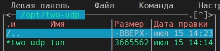
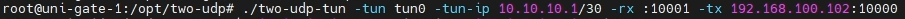
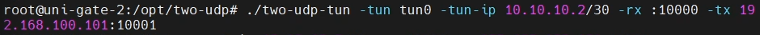
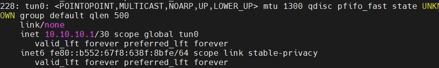
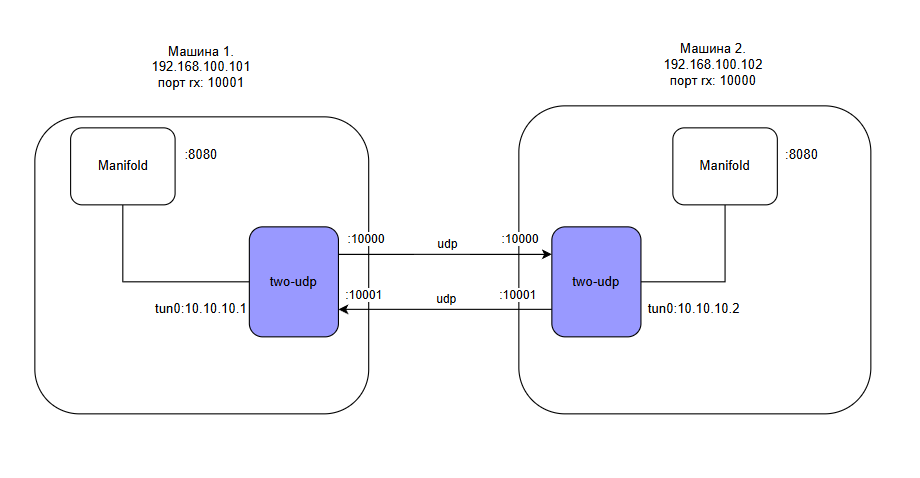
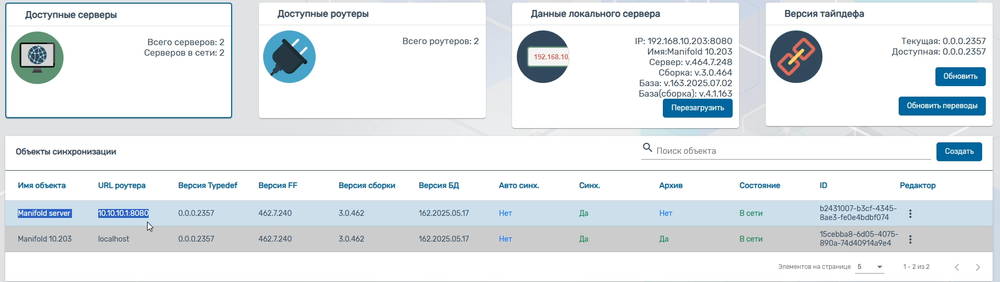
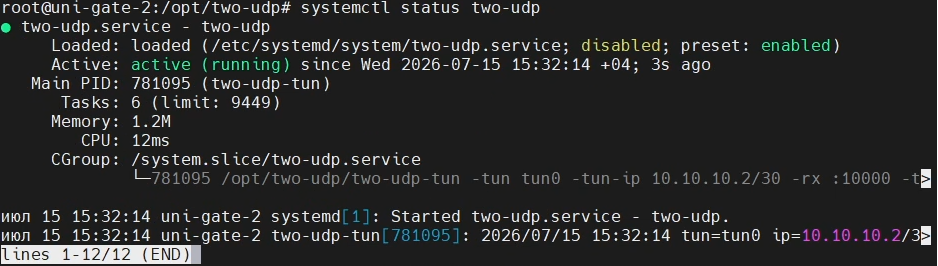

# Инструкция администратора по настройке сервиса two-udp

**Требования:** Linux amd64

Для реализации сервиса синхронизации через однонаправленный шлюз между двумя машинами используется программа two-udp. Программа представляет собой бинарный файл `two-udp`.

## 1. Настройка сервиса синхронизации

1. Поместить файл на обе машины.

   
   *Рисунок 1. Исполняемый файл two-udp-tun*
<br>
2. Запустить сервис с помощью команды ниже. Пример исполняемой строчки на двух машинах:

   
   *Рисунок 2. Команда для запуска сервиса на первой стороне*
<br>
   
   *Рисунок 3. Команда для запуска на второй стороне*

**Параметры запуска:**

* `./two-udp-tun` -- указываем исполняемый файл
* `-tun tun0` -- указываем интерфейс.

  > **ПРИМЕЧАНИЕ:** необходимо убедиться, что прописываемый интерфейс (в примере **tun0**) не занят другим сервисом (можно проверить командой `ip a` или `ip addr`). Если интерфейс уже занят, использовать другие, например `tun1`, `tun2` и тд.

* `-tun-ip «ip/подсеть»` - прописываем на машинах виртуальные ip адреса, по которым они смогут видеть друг друга. Достаточно /30 подсети, так как мы соединяем два узла по прямому каналу связи типа «точка-точка».
b
  > **ПРИМЕЧАНИЕ:** таким же образом необходимо убедиться, что данный ip адрес не занят другим интерфейсом.

* `-rx «:port»` - указываем порт **для приема** соединения (в примере :10001 на первой и :10000 на второй). Зеркально на другой машине порт может быть такой же или отличаться (Рисунок 3 -- порт rx).

  > **ПРИМЕЧАНИЕ:** порты rx берутся от сис.админа на том объекте, где настраиваем данную программу, то есть он должен сообщить нам, по каким ip адресам и udp портам машины в сети будут иметь доступ к друг другу.

* `-tx «ip:port»` -- указываем хост **для отдачи,** то есть куда отдаем пакеты. Здесь порт должен соответствовать порту **для приема(rx),** который указан на **другой машине.**

После успешного запуска программы на двух машинах, поднимутся два интерфейса. Машины смогут видеть друг друга по указанным виртуальным адресам (в примере 10.10.10.1 и 10.10.10.2).


*Рисунок 4. Поднятый интерфейс.*

**Таким образом**, у нас есть tun-интерфейсы с виртуальными адресами - тоннель для противоположной сети, в которой затем можно свободно ходить. По этим адресам будут доступны сервисы ца, firefly, манифолд, и т.д.

На рисунке 5 схематично отображена работа two-udp.


*Рисунок 5. Схематичное отображение работы two-udp.*

Благодаря проделанной настройке, теперь машины могут общаться напрямую, будто между ними tcp-тоннель.


*Рисунок 6. Отображение синхронизации в веб-компоненте «Администрирование сервера»*

Синхронизация будет работать до тех пор, пока не оборвется канал связи, либо не закроется сессия терминала.

Ниже представлена инструкция запуска программы в фоновом режиме.

---

## 2. Запуск two-udp в режиме службы

1. Создать файл: 
   `/etc/systemd/system/two-udp.service`

2. Вставить в файл:

```ini
   [Unit]
   Description=two-udp
   After=network.target

   [Service]
   Type=simple
   #--- Прописать свои настройки (см. Пункт 1. Инструкция two-udp)
   ExecStart=/opt/two-udp/two-udp-tun -tun tun0 -tun-ip 10.10.10.2/30 -rx :10000 --tx 192.168.100.101:10001
   Restart=always

   [Install]
   WantedBy=multi-user.target
```

3.  После создания или любого изменения файла, прописать команду:

- systemctl daemon-reload

4.  Запуск сервиса:

- systemctl start two-udp

5.  Автоматическое включение сервиса при запуске машины:

- systemctl enabled two-udp

если понадобится отключить данную функцию - systemctl disabled two-udp

6.  Проверить статус сервиса - systemctl status two-udp


*Рисунок 7. Включенный сервис two-udp*

**Особенности работы.**
При разрыве связи между двумя машинами, в клиенте можно наблюдать прекращение получения данных, однако информация в веб-компоненте «Администрирование сервера»(статус сервера должен стать «Не в сети») обновится не сразу, но через некоторое время \~до 1мин. Такая же задержка возможна и при восстановлении связи.