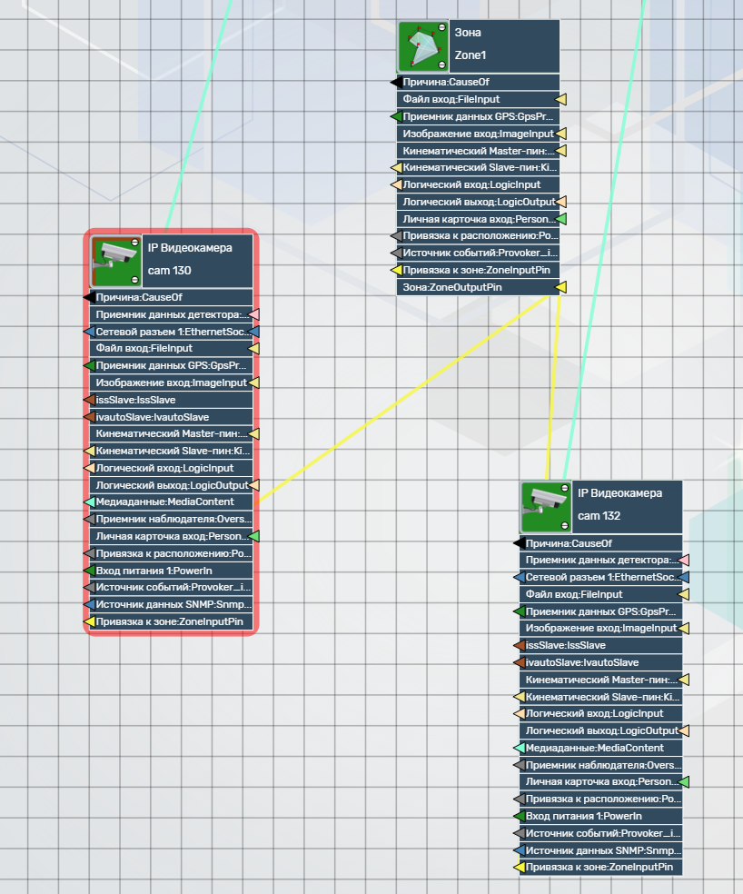
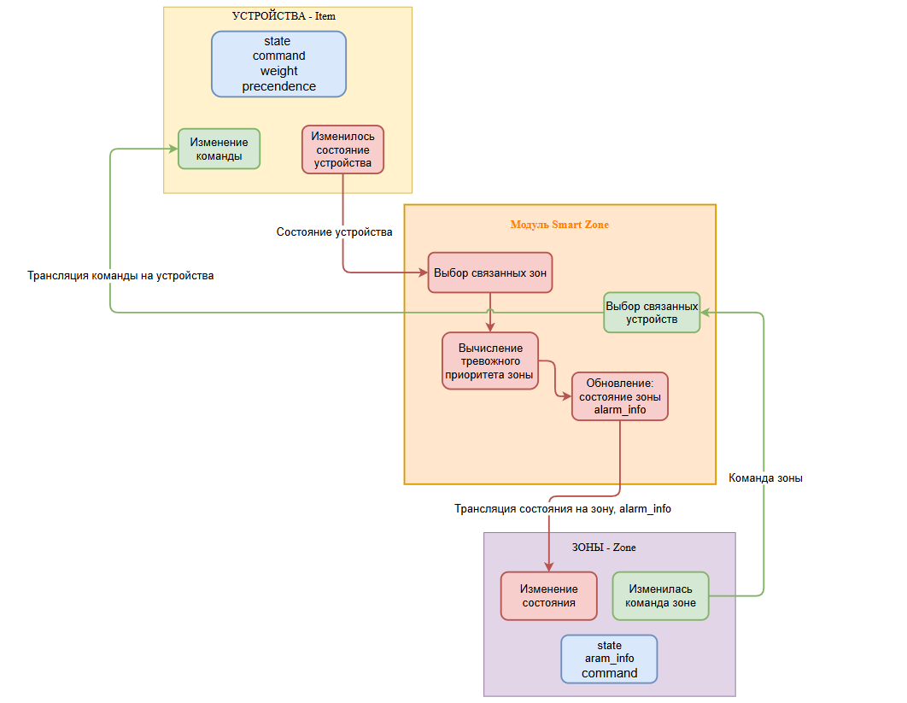
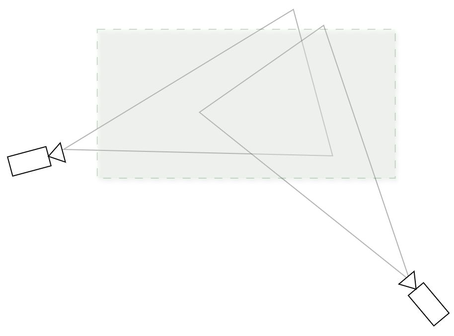
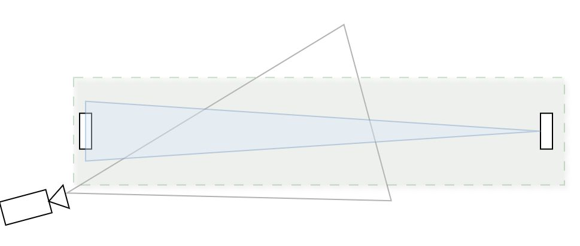
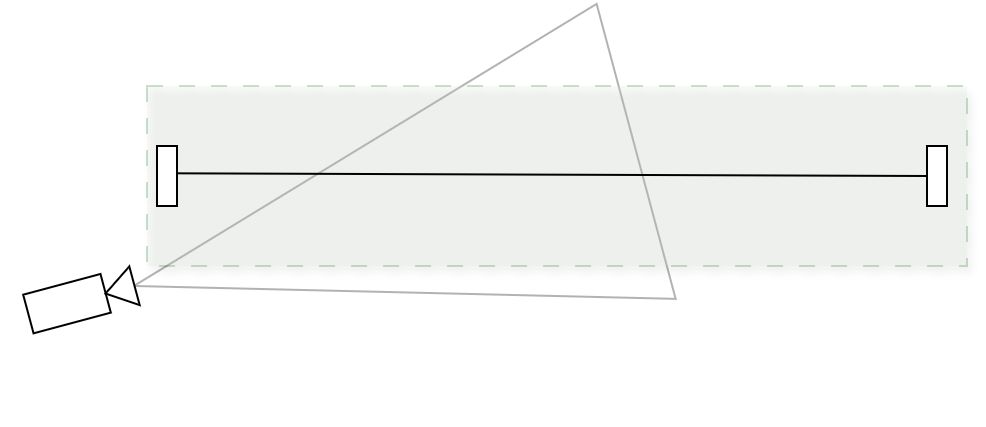
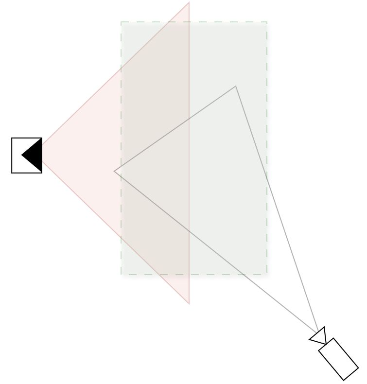
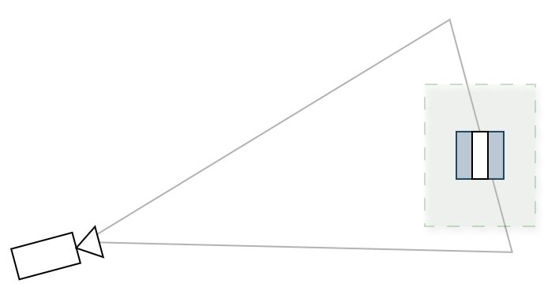
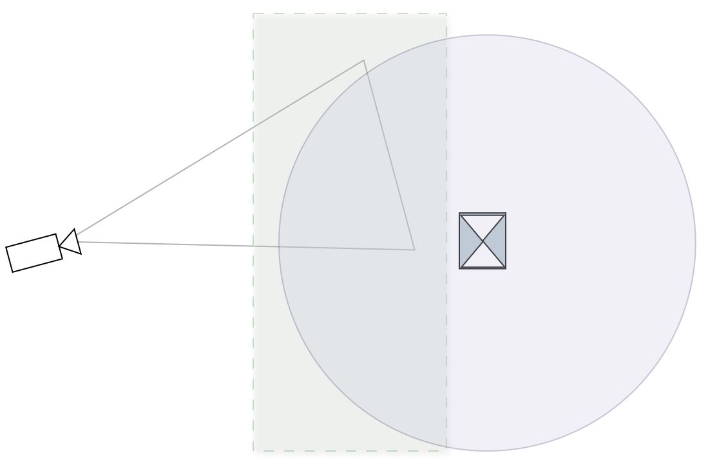
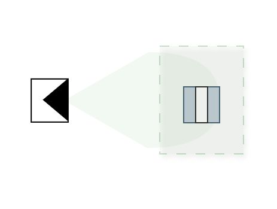
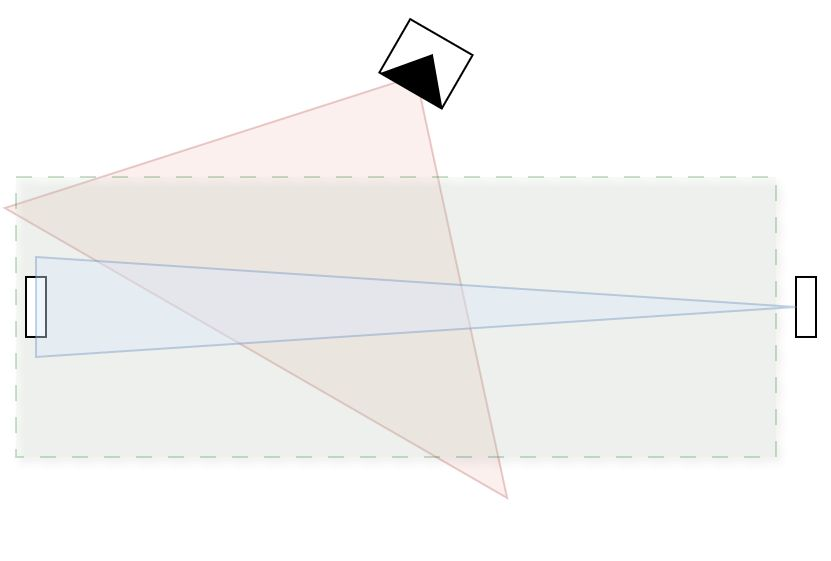

**УТВЕРЖДЕН**
ХХХХХХХХ.ХХХХХХ.ХХХ.И3-ЛУ

# Программное обеспечение модуль «Смарт-Зона»

## Описание применения
*В составе программного комплекса «Интегра 4D-Планета Земля»*
RU.ХХХХ.ХХ.ХХ 31 01-1
Листов

### Аннотация

Документ содержит сведения о назначении, возможностях, основных характеристиках, условиях применения программного обеспечения модуль «Смарт-Зона», являющегося компонентом программного комплекса «Интегра 4D-Планета Земля». Модуль функционирует в серверной части программного комплекса и предназначен для создания и автоматизированного управления логическими охранными зонами, в которые агрегируется состояние подключенных технических средств.

Документ предназначен для администраторов и операторов комплекса, а также для проектировщиков и специалистов в области обеспечения безопасности.

Эксплуатация программного продукта должна производиться персоналом, имеющим навыки работы с компьютерным оборудованием, программным обеспечением.

Характер изложения данного документа предполагает, что персонал, осуществляющий эксплуатацию, знаком с операционными системами семейства Linux, таких как Debian, Ubuntu, RedHat/CentOS и с операционными системами Microsoft®, начиная с Windows® 7.

Комплект программной документации на программный продукт выполнен в соответствии с требованиями ГОСТ 19.105-78 «ЕСПД. Общие требования к программным документам» и ГОСТ Р 59795-2021.

Все продукты, технические средства и сведения о них, которые упоминаются в настоящем документе, являются интеллектуальной собственностью Консорциума «Интегра-С».

---

### Оглавление

* [1. Назначение программы](#1-назначение-программы)
  * [1.1 Вид деятельности, для которой применяется программа](#11-вид-деятельности-для-которой-применяется-программа)
  * [1.2 Функциональное назначение](#12-функциональное-назначение)
  * [1.3 Ограничения применения](#13-ограничения-применения)
* [2. Условия применения](#2-условия-применения)
  * [2.1 Технические средства (требования к аппаратуре)](#21-технические-средства-требования-к-аппаратуре)
  * [2.2 Программное обеспечение](#22-программное-обеспечение)
  * [2.3 Общие условия применения](#23-общие-условия-применения)
* [3. Описание задачи](#3-описание-задачи)
  * [3.1 Суть решаемой задачи](#31-суть-решаемой-задачи)
  * [3.2 Способ решения](#32-способ-решения)
  * [3.3 Порядок подготовки проектного решения](#33-порядок-подготовки-проектного-решения)
  * [3.4 Перечень операций по пусконаладке и настройке модуля](#34-перечень-операций-по-пусконаладке-и-настройке-модуля)
* [4. Входные и выходные данные в системе](#4-входные-и-выходные-данные-в-системе)
  * [4.1 Входные данные для модуля «Смарт-Зона»](#41-входные-данные-для-модуля-смарт-зона)
  * [4.2 Выходные данные](#42-выходные-данные)
* [5. Работа оператора](#5-работа-оператора)
  * [5.1 Отображение тревожных событий](#51-отображение-тревожных-событий)
  * [5.2 Фильтрация событий по уровню тревоги зоны](#52-фильтрация-событий-по-уровню-тревоги-зоны)
  * [5.3 Регламент действий](#53-регламент-действий)
* [6. Типовые Смарт-Зоны (для комбинаций групп детекторов)](#6-типовые-смарт-зоны)
* [7. Рекомендации к освоению](#7-рекомендации-к-освоению)
* [Лист регистрации изменений](#лист-регистрации-изменений)

---

# 1. Назначение программы

## 1.1 Вид деятельности, для которой применяется программа.

Модуль «Смарт-Зона» (далее «модуль») является серверным программным компонентом программного комплекса «Интегра 4D - Планета Земля» (далее «Интегра-Планета»). Модуль обеспечивает создание логических охранных зон (смарт-зон), состояние которых определяется путем агрегирования и анализа состояния физических зон контроля технических средств и зон детекции программных алгоритмов. Модуль также служит для автоматизированного управления логическими охранными зонами: одновременной постановкой на охрану или снятием с охраны включенных в ее состав технических средств.

Программный компонент применяется для мониторинга обстановки охраняемых зон - одной из ключевых функций системы. Основное назначение модуля --- **автоматизация** оценки состояния защищаемых зон: оператор получает готовое сводное состояние зоны, вычисленное системой, вместо самостоятельного сопоставления сигналов множества устройств.

Основные задачи, решаемые модулем:
* агрегация состояний двух и более физических и/или программных детекторов (охранных датчиков, детекторов видеоаналитики) в единое логическое состояние охраняемой зоны;
* автоматический расчёт достоверности тревоги на основании весовых коэффициентов и важности состояний устройств, входящих в зону;
* ранжирования тревог зоны по степени достоверности;
* снижение нагрузки на оператора мониторинга за счёт фильтрации недостоверных (маловероятных) тревожных событий;

## 1.2 Функциональное назначение.

Модуль «Смарт-Зона» представляет собой Node-RED-поток, реализующий алгоритм автоматизированной трансляции состояний устройств (датчиков, камер, контроллеров и иных объектов) в состояние логической зоны (объект типа Zone), объединяющей эти устройства связями типа ZoneLink.

Пример схемы в СКАДА (Рисунок 1):


*Рисунок 1. Пример схемы для работы модуля Smart Zone*

* **Зона (Zone1)** --- логическая зона охраняемого объекта, агрегирует состояния устройств.
* **IP Видеокамера** --- item устройства (камеры, датчики, светильники и т.д.) связанные с логической зоной, на которую будут транслироваться состояния данных устройств.
* **ZoneLink** --- линк (связь) между Zone и Item, указывающая, что устройство входит в состав зоны. Содержит параметр **weight** (вес устройства в зоне), учитывающийся в алгоритме расчета (см. пункт Описание задачи).

В таблице 1 сведены функциональные возможности модуля:

*Таблица 1. Функциональные возможности*

| № | Функция | Описание |
| :---: | :--- | :--- |
| **Ф1** | Трансляция состояний датчиков в состояние зоны | Система вычисляет текущее состояние зоны как агрегат состояний всех связанных устройств с учётом весов связей, приоритетов устройств и важности состояний. |
| **Ф2** | Расчет тревожного приоритета охраняемой зоны | Тревожный приоритет зоны рассчитывается как взвешенная сумма приоритетов тревожных членов зоны и сопоставляется с пороговой таблицей для определения тревожного уровня зоны. |
| **Ф3** | Отсечение ложных срабатываний | Перевод зоны в тревожное состояние возможен только при достижении суммарным тревожным приоритетом зоны заданного порога; кратковременные срабатывания устройств короче заданного времени не вызывают изменения состояния зоны. |
| **Ф4** | Дублирование согласованного состояния | Если при включенной настройке is_duplicate в модуле, у всех связанных с зоной датчиков **одинаковое состояние**, это состояние будет продублировано в зону (если такое состояние у зоны существует). |
| **Ф5** | Диагностика тревоги | При изменении состояния зоны модуль формирует структуру **alarm_info** с перечнем устройств, вызвавших тревогу, их весами, приоритетами и текущими состояниями. |
| **Ф6** | Трансляция команд зоны | Команда, заданная зоне (например, «взять под охрану» / «снять с охраны»), автоматически продублируется на все устройства, входящие в состав зоны. |

## 1.3 Ограничения применения

Функционал модуля «Смарт-Зона» реализуется эффективно только в пространстве, где области детекции двух и более устройств пересекаются либо совместно контролируют один и тот же участок зоны. Применение модуля для одиночного (несвязанного) датчика нецелесообразно.

При проектировании системы необходимо учитывать, что зона действия одного физического детектора (например, широкоугольной видеокамеры) может входить в состав нескольких независимых Смарт-Зон с различной логикой обработки.

Рекомендуется закреплять наблюдаемые зоны за зонами ответственности с учётом фактической нагрузки на операторов рабочих мест, а также предусматривать процедуру передачи зон ответственности между рабочими местами на случай временного отсутствия оператора.

* Модуль не детектирует тревоги самостоятельно --- он агрегирует только состояния устройств, поступающие из подсистемы Интегра-Планета в реальном времени. Корректность работы модуля обусловлена своевременным поступлением состояний устройств.
* Модуль не управляет устройствами, за исключением трансляции команды зоны на устройства (Ф6).
* Модуль не формирует тревожные события.
* Модуль не размещает объекты на схеме --- зоны, устройства и связи между ними создаются администратором на схеме SCADA до запуска модуля.
* Модуль не обрабатывает устройства, не связанные ни с одной зоной.
* Модуль зависит от корректной конфигурации (пороги, весы, приоритеты, см. Способ решения задачи).

# 2. Условия применения

## 2.1 Технические средства (требования к аппаратуре)

Требования к аппаратуре (железу) для работы модуля **«Смарт Зона»** определяются масштабом всей интеграционной платформы «Интегра-Планета» в которую этот модуль встроен.

Минимальные системные требования к конфигурации клиентского рабочего места приведены в таблице 2.

*Таблица 2. Минимальные системные требования*

| Элемент | Параметры |
| :--- | :--- |
| **Процессор** | Intel Core i5-10400f |
| **Оперативная память** | 16 gb |
| **Видеокарта** | NVIDIA GeForce 1050 Ti |
| **Операционная система** | Windows 10 x64, Debian 11 |
| **Свободное место на диске** | 5 Gb |

## 2.2 Программное обеспечение

*Таблица 3. Программное обеспечение для работы модуля*

| Позиция | Компонент | Назначение |
| :--- | :--- | :--- |
| **ОС Сервера** | Linux (Астра Линукс, RedOS, Debian, Ubuntu, RedHat/CentOS) | Среда работы серверной части «Планета-Земля» |
| **ОС рабочих мест** | Астра Линукс, RedOS, Windows 11 x64 / Debian | Среда работы АРМ оператора |
| **Среда выполнения** | ПО «Интегра 4D-Планета Земля» | Выполняет функцию клиентской части системы. Отображает информацию о состоянии охраняемого объекта с применением 3D-планов, а также позволяет управлять расположением графических элементов на 3D-плане |
| **Сервер приложения** | Интегра 4D-Планета земля: сервер приложения. | Серверное приложение, являющееся центральным звеном «Интегра-Планета». Обеспечивает взаимодействие подсистем ССОИ с БД. На сервер приложения приходят все изменения с клиента (СКАДА, Интегра-Планета и тд.) и обновляются в базе данных сервера приложения. |
| **Администрирование схем связей и топологии** | Интегра 4D-Планета земля: СКАДА | Графический редактор настройки топологии (зоны, устройства, связи и т.д) и объектов системы в составе ПО «Интегра-Планета». |

## 2.3 Общие условия применения

**Организационные.**
1. **Администратор ССОИ**: выполняет развёртывание модуля (импорт потока, настройка глобальных узлов подключения к источникам данных, запуск потока), обеспечивает доступность «Интегра-Планета» и источников данных, а также создает и настраивает логическую топологию в редакторе СКАДА (см. п. 3.4). Действия выполняются с правами, назначенными по правам доступа ЦА.
2. **Проектирование систем безопасности:** проектировщик при подготовке проектного решения по обеспечению безопасности объекта приводит в документации необходимые сведения для установки и работы модуля (см. п. 3.3, п. 3.4).
3. **Оператор/диспетчер АРМ**: наблюдает состояния зон в интерфейсе системы, реагирует на тревожные события. Оператор не выполняет действий, изменяющих конфигурацию модуля (см. п. 5).

**Временные и режимные условия.**
* модуль работает **в фоновом автономном режиме** круглосуточно после развёртывания, без участия оператора;
* пуск/остановка модуля совпадает с пуском/остановкой серверной среды «Интегра 4D-Планета Земля»;
* период пересчёта зон --- **1 с**; минимальная задержка отражения изменения состояния устройства в состояние зоны --- порядка одного-двух циклов (≈ 1--2 с) плюс интервал, задаваемый *alarm_timeout* (см. Таблица 4);
* изменения настроек модуля (узел «Настройки и таймер») применяются **без перезапуска** модуля (в течение следующего цикла таймера);
* значение *alarm_timeout* рекомендуется устанавливать **не менее 2 с** (для корректной работы механизма продления тревоги при периоде пересчёта 1 с).

> **Ограничение:**
> Работа модуля обусловлена доступностью источников данных «Интегра 4D-Планета Земля». При прерывании доставки событий от источников данных состояния зон сохраняют последнее вычисленное значение и не обновляются до восстановления. После восстановления периодическая сверка приводит состояния зон в соответствие с фактическими.

# 3. Описание задачи

На объекте безопасности эксплуатируются десятки и сотни устройств (камеры, датчики). Каждое устройство самостоятельно сообщает о тревоге. Оператору, наблюдающему за объектом, необходимо видеть сводную картину по логическим зонам (участок периметра, здание, помещение), а не анализировать состояния устройств по одному.

## 3.1 Суть решаемой задачи

* оператору, работающему с системами безопасности, может быть затруднительно оценивать обстановку по одиночным состояниям устройств --- требуется **агрегированное состояние зоны**, отображаемое на плане объекта и в 3D-сцене;
* одиночная неисправность или ложное срабатывание одного устройства не должна приводить к тревоге всей зоны;
* зона не должна «мигать» (повторно изменять состояние) при кратковременных и последовательных срабатываниях;
* оператор должен иметь возможность быстро определить, какие именно устройства являются причиной тревоги в зоне.

## 3.2 Способ решения

Модуль «Смарт-Зона» решает эту задачу автоматическим вычислением состояния зоны по состояниям связанных с ней устройств, с применением взвешенной оценки тревожного приоритета.


*Рисунок 2. Схема работы модуля «Смарт-Зона»*

Суть подхода --- вычисление численного приоритета (суммарного тревожного приоритета зоны) на основе параметров каждого устройства в тревожном состоянии и сопоставление полученного значения с настраиваемыми порогами, определяющими итоговое состояние зоны.

Модуль «Смарт-Зона» рассчитывает для охраняемой зоны приоритет тревожности по совокупности следующих параметров по каждому устройству, связанному с зоной:

* **weight (вес связи)** --- показатель веса ZoneLink (см. Рисунок 1), соединяющий устройство с зоной, отражающий значимость вклада данного устройства в оценку состояния зоны;
* **precedence устройства (приоритет обработки)** --- параметр устройства (0--100), задающее тяжесть его тревожного сигнала с точки зрения охраняемого объекта;

> **ПРИМЕЧАНИЕ:** На параметр **precedence** также может влиять настройка **importance (коэффициент важности состояния)** --- множитель, задаваемый в настройках модуля по типу устройства и состоянию.
> Например, переход поворотной камеры в состояние «Тревога» будет удваивать параметр precedence.

* **текущее состояние устройства** с учетом продления тревоги: устройство, у которого тревога уже сброшена, продолжает учитываться как находящееся в тревоге в течение **alarm_timeout (настраивается в модуле «Смарт-Зона»)** секунд после сброса.

Модуль отрабатывает при каждом изменении состояния устройств и команд зон.

Ключевые настраиваемые параметры приведены в таблице 4.

*Таблица 4. Сводная таблица параметров для работы модуля «Смарт-Зона»*

| Параметр | Назначение | Где настраивается | Пример |
| :--- | :--- | :--- | :--- |
| **alarm_timeout** | Время удержания тревожного состояния датчика после его фактического сброса | Модуль «Смарт-Зона» | `10 с.` |
| **importance** | Таблица коэффициентов важности (весовой множитель) состояния устройства конкретного типа | Модуль «Смарт-Зона» | `{"IpVideoCamera":{"alarm.alarm":2}}` |
| **precedence (порог)** | Определяет порог суммарного тревожного приоритета и соответствующих состояний зоны:<br><br>0-9: трансляция состояния не выполнится, Зона не изменит состояние.<br><br>10-59: у зоны состояние будет = Маловероятная тревога (alarm.unlikely).<br><br>60-89: у зоны состояние будет = Вероятная тревога (alarm.likely).<br><br>90 и выше: у зоны состояние будет = Тревога (alarm.alarm). | Модуль «Смарт-Зона» | `{"alarm.unlikely": 10, "alarm.likely": 60, "alarm.alarm": 90}` |
| **is_duplicate** | Дублирование единого состояния устройств в состояние зоны. Для критичных зон рекомендуется **is_duplicate = true** --- для визуального дублирования единообразного состояния всех датчиков зоны. | Модуль «Смарт-Зона» | `true/false` |
| **precedence (устройства)** | Индивидуальный приоритет устройства, используемый при расчёте суммарного показателя тревожности зоны. | Редактор Скада | `50` |
| **ZoneLink** | Тип связи, соединяющей устройство (например, IpVideoCamera) с объектом Zone. | Редактор Скада | Итемы камер соединены с зоной |
| **write_alarm_only** | Если true, то в alarm_info будут записываться только объекты, состояние которых является alarm. | Модуль «Смарт-Зона» | `true/false` |

## 3.3 Порядок подготовки проектного решения

При подготовке проектного решения по оснащению объекта средствами обеспечения безопасности, проектировщик определяет и приводит в проектной документации следующие сведения:

1. Параметры и конфигурацию зон контроля технических средств и зон детекции программных алгоритмов на сводном плане защищаемого объекта. При этом необходимо обеспечить доступность данных о координатах границ зон контроля для сотрудников пуско-наладочной организации. Координаты границ зон контроля приводятся в табличном виде в местной системе координат, либо сводный план разрабатывается в формате, позволяющем извлечь указанные координаты.
2. **Необходимость и обоснование применения модуля в заданных условиях**. В целях снижения нагрузки на оператора сил обеспечения безопасности при выполнении им обязанностей по контролю данных (информации) от технических средств, проектом должно предусматривается применение модуля «Смарт-Зона». Применение модуля не противоречит требованиям законодательства и нормативных документов в области обеспечения безопасности. Автоматизация контроля данных (информации) от технических средств не исключает управляющих воздействий от оператора, при этом акцентируя его внимание на приоритетных событиях.
3. Параметры и конфигурацию логических охранных зон (смарт-зон) на сводном плане защищаемого объекта в соответствии с п.6. При этом для каждой смарт-зоны необходимо указать перечень и весовой коэффициент технических средств, зоны контроля которых включены в смарт-зону.
4. Ведомость объемов пуско-наладочных работ по развертыванию модуля на объекте (перечень работ см. п. 3.4).

## 3.4 Перечень операций по пусконаладке и настройке модуля «Смарт-Зона»

*Примечание:* Физический монтаж оборудования, интеграция устройств в систему «Интегра-Планета» и стабильная передача данных считается уже выполненным и в данный перечень ПНР не входят.

**Этап 1. Формирование логической топологии**
1. **Инструмент настройки:** редактор СКАДА
2. **Что настраивается:**
   * Предварительное создание логической топологии объекта, в которой создается пространство эксплуатируемого объекта, привязка к серверной инфраструктуре.
   * Создание зон и устройств: Добавление в настроенную топологию логических охраняемых зон и устройств.
   * Привязка устройств к зоне: Привязка созданных итемов (Item) датчиков и видеокамер с объектом Zone посредством создания связей ZoneLink (см. Рисунок 1).
   * Привязка весов: Назначение весовых коэффициентов непосредственно на созданные связи ZoneLink и настройка индивидуальных приоритетов устройств (precedence).
3. **Необходимо учитывать:** экспертные рекомендации по весам для каждого датчика из проектной документации и фактических слепых зон конкретных камер/датчиков.

**Этап 2. Настройка вычислительной логики (выполняется в параметрах модуля Smart-Zone)**
1. **Инструмент настройки:** Серверная среда исполнения Node-RED, настройки модуля «Смарт-Зона».
2. **Что настраивается:**
   * Развертывание: Импорт модуля «Смарт-Зона» на серверную инфраструктуру объекта.
   * Привязка порогов: Назначение пороговых значений суммарного приоритета (precedence), при которых логическая зона будет менять свое состояние.
   * Привязка коэффициентов важности: Настройка множителей (importance), которые привязываются к конкретным типам устройств (например, IpVideoCamera) и их текущим состояниям.
   * Настройка остальных параметров для корректной работы модуля на объекте (см. таблица 4).
3. **Необходимо учитывать:** экспертные рекомендации по весам для каждого датчика, необходимые режимы отображения угроз на объекте (нормальный, повышенный, критический), деградации датчиков при потере связи.

**Этап 3. Пространственная привязка (выполняется в клиенте «Интегра 4D-Планета Земля»)**
1. **Инструмент настройки:** Функционал клиента «Интегра 4D-Планета Земля»
2. **Что настраивается:**
   * Отрисовка полигона зоны, привязка созданной логической зоны к физическому пространству объекта (например, выделение периметра кровли, зоны под мостом или секции ограждения).
3. **Необходимо учитывать:** топология местности --- точное совпадение нарисованного полигона с фактическим участком.

# 4. Входные и выходные данные в системе

## 4.1 Входные данные для модуля «Смарт-Зона»

*Таблица 5. Входные параметры.*

| № | Параметр | Структура / формат | Источник | Назначение |
| :---: | :--- | :--- | :--- | :--- |
| **1** | Изменение состояния устройства *state* | Строка (`ok.*`, `alarm.*`, `error.*`, `none.*`) + метка времени | Подсистемы СОС, СКУД, АПС, СТС; сервер am «Интегра-Видео»; серверы трекинга | Основной вход для расчёта состояния зоны |
| **2** | Приоритет устройства *precedence* | Число ≥ 0 | СКАДА-редактор | Вклад устройства в тревожный приоритет зоны |
| **3** | Вес связи *weight* (ZoneLink) | Число ≥ 0 (участвуют связи с weight > 0) | СКАДА-редактор | Взвешивание устройства в зоне |
| **4** | Фактор зоны *alarm_factor* | Число > 0 (по умолчанию 1) | СКАДА-редактор | Делитель суммарного приоритета зоны |
| **5** | Команда зоне *command* | Значение параметра команды (взять под охрану / снять с охраны / игнорировать) | Оператор через клиент «Интегра 4D --- Планета Земля» | Трансляция на устройства зоны |
| **6** | Связи *ZoneLink* (Zone ↔ Item) | Связи цифрового графа с атрибутом weight | СКАДА-редактор (проектировщик) | Определение состава зоны |
| **7** | Тип устройства | Иерархия типов (например, `BaseObject` → `IpVideoCamera`) | typedef (текущая версия в FireFly) | Выбор важности состояния из таблицы |
| **8** | Текущее состояние зоны *state* (Zone) | Иерархическая строка + метка времени | Серверная часть ССОИ | Сравнение «до/после», гистерезис |
| **9** | Перечисление допустимых состояний зон *Zone_states* | Перечисление типов | typedef (текущая версия в FireFly) | Проверка состояний для дублирования |

## 4.2 Выходные данные

*Таблица 6. Выходные параметры.*

| № | Параметр | Структура / формат | Потребитель | Назначение |
| :---: | :--- | :--- | :--- | :--- |
| **Х1** | Состояние зоны *state* | Иерархическая строка: `ok.normal`, `ok.inactive`, `alarm.unlikely`, `alarm.likely`, `alarm.alarm`, `error.defective`, `none.unknown` + метка времени | Клиент «Интегра 4D --- Планета Земля» (планы, 3D-сцена, мониторинг состояний, менеджер событий); подсистемы оповещения; внешние интеграции | Агрегированное состояние охраняемого участка (зональный контроль) |
| **Х2** | Диагностика тревоги зоны *alarm_info* | JSON (структура см. ниже) | Клиент «Интегра 4D --- Планета Земля»; подсистемы анализа, внешние системы | Причина тревоги: расчётный приоритет, состояние «до/после», перечень сформировавших устройств |
| **Х3** | Команда устройствам *command* | Значение команды (как у зоны) | Драйверы/шлюзы устройств через FireFly | Выполнение групповых действий над устройствами зоны |
| **Х4** | Сервисные данные | Счётчик «обработано зон ➝ сформировано изменений» (статус узла), сообщения журнала | Администратор ССОИ | Мониторинг работоспособности модуля |

**Структура *alarm_info* (значение параметра зоны):**

```json
{
  "alarm_factor": 1.0,
  "alarm_precedence": 84.0,
  "state_before": "ok.normal",
  "state_after": "alarm.likely",
  "members": {
    "<id_устройства_1>": {
      "type": "IpVideoCamera",
      "state": "alarm.alarm",
      "datetime": "2025-01-01T12:00:00",
      "weight": 1,
      "precedence": 60,
      "importance": 2,
      "alarm": true,
      "value": "ok.normal"
    },
    "<id_устройства_2>": { "...": "..." }
  }
}
```

* *alarm_factor* --- делитель приоритета, действовавший на момент расчёта;
* *alarm_precedence* --- суммарный тревожный приоритет зоны после деления;
* *state_before / state_after* --- предыдущее и вычисленное состояние зоны;
* *members* --- словарь устройств-причин тревоги (при *write_alarm_only = true* --- только фактически тревожных); ключ --- идентификатор устройства, значение --- структура п. 3.2.3.

# 5. Работа оператора

## 5.1 Отображение тревожных событий.

Для оператора все тревожные события, происходящие на одном или нескольких объектах, собираются и отображаются в режиме реального времени в окне «Менеджер событий». Каждое изменение состояния зоны отображается отдельной строкой (событием) со временем, источником и текущим состоянием.


*Рисунок 3. Окно «Менеджер событий».*

## 5.2 Фильтрация событий по уровню тревоги зоны

В «Менеджере событий» доступен фильтр «Режим угроз» , основанный на **состоянии зоны**.


*Рисунок 4. Включение фильтра на панели инструментов*

Данный фильтр применяется к тревожным событиям по зоне и срабатывает в зависимости от состояния по событию зоны и включает в себя 3 уровня отображения:

*Таблица 7. Режимы отображения событий на АРМ оператора*

| Режим отображения | Какие состояния зон выводит |
| :--- | :--- |
| **Нормальный** | Тревога (`alarm.alarm`) |
| **Повышенный** | Тревога (`alarm.alarm`),<br>Вероятная тревога (`alarm.likely`) |
| **Критический** | Выводит все события:<br>Тревога (`alarm.alarm`),<br>Вероятная тревога (`alarm.likely`),<br>Маловероятная тревога (`alarm.unlikely`) |

**Следствие для проектирования:** выбранные в проекте пороги параметра precedence (см. Таблица 4) определяют, какие события зоны попадут в каждый режим отображения. Проектировщик учитывает это при выборе режимов работы диспетчерской смены.

## 5.3 Регламент действий

Регламент действий --- это веб-компонент, реализованный в виде настраиваемого уведомления с действиями, автоматически открываемое при поступлении события.

В результате при получении нового события, для оператора автоматически откроется окно регламента действий. В качестве примера на рисунке 5 приведено уведомление о тревожном событии в зоне.


*Рисунок 5. Уведомление.*

1. **«Отклонить и снять с охраны»** - событие считается отмененным, в комментарии пишется «Отменено». Все связанные с событием устройства снимаются с охраны на таймаут (по умолчанию 5 минут).
2. **«Включить оповещение»** - включает связанную фразу оповещения (отправить команду на связанные по зоне громкоговорители с номером файла воспроизведения), согласно типу события. Файл для воспроизведения необходимо выбирать в соответствии с типу пришедшего события. Также, при нажатии на эту кнопку событие получает статус «Принято» и создается карточка происшествия.
3. **«Передать старшему оператору»** - событие считается подтвержденным, в комментарий пишется «Передано на подтверждение», создается карточка происшествия и назначается на соответствующую группу.
4. **«Подтвердить тревогу (с созданием карточки происшествия)»** - создается событие с созданием карточки происшествия.
5. **«Подтвердить тревогу»** - создается событие без создания карточки происшествия.
6. **«Отклонить тревогу»** - событие считается отмененным, в комментарии пишется «Отклонено».

# 6. Типовые Смарт-Зоны 

Для комбинаций групп детекторов различного типа. Для каждой комбинации приведены:
* **Назначение** --- какую задачу решает данная пара в составе Смарт-Зоны;
* **Параметры установки** каждого детектора (высота, направление, углы, дальность, мёртвые зоны и иные монтажные требования, влияющие на корректность формирования зоны детекции);
* **Диапазон веса связи (importance)** каждого детектора для данной комбинации --- экспертное стартовое значение, используемое до начала **автоматического перерасчёта** весов ПО «Интегра-Планета» в процессе эксплуатации;
* **Место для размещения графической схемы** зон детекции пары.

Итоговый вес связи для каждого устройства всегда лежит в диапазоне **0,1--1,0** (0,1 --- минимальное влияние на итоговый расчёт, 1,0 --- максимальное/полное доверие к показаниям датчика). Указанные ниже диапазоны являются рекомендуемыми стартовыми значениями importance и подлежат уточнению проектировщиком/пусконаладчиком.

### В.1. Смарт-Зона: Видеодетектор + Видеодетектор

**Назначение.** Формируется в зоне перекрытия полей зрения двух видеокамер с видеоаналитикой (детекция движения/пересечения линии/присутствия объекта), контролирующих один участок с разных ракурсов. Применяется для исключения ложных срабатываний видеоаналитики, вызванных бликами, засветкой, движением веток/теней, попаданием насекомых в объектив одной из камер.

| Параметр установки | Камера №1 | Камера №2 |
| :--- | :--- | :--- |
| **Высота установки H, м** | Указывается проектом (рекомендуется 3--6 м) | Указывается проектом |
| **Азимут направления A, град.** | По проекту | По проекту, желательно под углом ≥ 30--45° к камере №1 (разные ракурсы) |
| **Угол обзора FOV, град.** | По ТХ камеры/объектива | По ТХ камеры/объектива |
| **Дальность эффективной детекции R_min--R_max, м** | По паспорту детектора видеоаналитики | По паспорту детектора видеоаналитики |
| **Угол наклона (тангаж) φ, град.** | По проекту | По проекту |
| **Мёртвая зона** | Зона под опорой камеры, зона за пределами R_max / при недостаточной освещённости | Аналогично |
| **Дополнительно** | Учитывать засветку ИК-подсветкой соседней камеры в ночное время | Учитывать взаимную засветку |

**Диапазон веса связи (importance):** 0,5--0,7 для каждой камеры (равнозначные по типу детекторы; при разной разрешающей способности/качестве аналитики веса могут быть дифференцированы в пределах диапазона).


*Рисунок 6. План участка с секторами обзора двух камер и зоной их пересечения*

### В.2. Смарт-Зона: Радиоволновой извещатель + Видеодетектор

**Назначение.** Совместный контроль открытого участка/периметра: радиоволновой извещатель обеспечивает всепогодное обнаружение движения, видеодетектор --- визуальное подтверждение и снижение реакции на природные помехи (ветер, осадки, животные), характерные для радиоволновых извещателей.

| Параметр установки | Радиоволновой извещатель | Видеокамера |
| :--- | :--- | :--- |
| **Высота установки H, м** | 0,5--1,2 м (по паспорту) | 3--6 м |
| **Направление / ориентация** | Ось диаграммы направленности вдоль контролируемого участка | Азимут A, ориентирован на ту же зону |
| **Форма и размеры зоны обнаружения** | Эллипс: большая полуось a, малая полуось c (по паспорту, типовые значения 10--50×3--10 м) | Сектор: FOV, R_min--R_max |
| **Мёртвые зоны** | Ближняя зона нечувствительности у извещателя (обычно 0,5--1 м от точки установки) | Зона под опорой камеры, зона вне угла обзора |
| **Ограничения** | Чувствителен к крупным металлическим объектам, движению растительности, осадкам | Зависит от освещённости, требует ИК-подсветки в тёмное время |

**Диапазон веса связи (importance):**
* радиоволновой извещатель: 0,6--0,8;
* видеодетектор: 0,5--0,7.


*Рисунок 7. Зона радиоволнового извещателя и сектор камеры*

### В.3. Смарт-Зона: Вибрационный извещатель + Видеодетектор

**Назначение.** Контроль ограждения/периметра: вибрационный извещатель (кабельный/точечный) фиксирует механическое воздействие на заграждение (перелаз, деформация), видеодетектор подтверждает наличие нарушителя, снижая реакцию на воздействие ветра, вибрации от транспорта, животных.

| Параметр установки | Вибрационный извещатель | Видеокамера |
| :--- | :--- | :--- |
| **Способ прокладки/установки** | Вдоль полотна ограждения (кабель) или в точках крепления (точечный датчик) | На опоре, обзор вдоль линии ограждения |
| **Высота установки H, м** | По высоте ограждения (обычно 1,5--2,5 м) | 3--6 м |
| **Зона действия (полоса)** | Ширина зоны чувствительности b (по паспорту, типично 1--3 м по обе стороны линии) | Сектор FOV, R_min--R_max вдоль того же участка |
| **Длина контролируемого участка** | По проекту, с учётом максимальной длины зоны на один шлейф | --- |
| **Мёртвые зоны** | Места жёсткого крепления/углов ограждения с пониженной чувствительностью | Зона вне сектора обзора, «слепые» углы у опор |
| **Ограничения** | Чувствителен к ветровой нагрузке, наездам транспорта вблизи ограждения | Зависит от освещённости и наличия растительности вдоль ограждения |

**Диапазон веса связи (importance):**
* вибрационный извещатель: 0,6--0,9 (зависит от типа: точечный --- ближе к 0,6; кабельный распределённый --- ближе к 0,8--0,9);
* видеодетектор: 0,5--0,7.


*Рисунок 8. Полоса чувствительности вдоль ограждения и сектор камеры, зона пересечения*

### В.4. Смарт-Зона: Оптоволоконный извещатель + Видеодетектор

**Назначение.** Контроль протяжённого периметра/ограждения оптоволоконным чувствительным кабелем совместно с видеонаблюдением. Оптоволоконный извещатель обладает высокой помехоустойчивостью (нечувствителен к электромагнитным помехам), видеодетектор используется для визуального подтверждения и локализации нарушителя по зонам.

| Параметр установки | Оптоволоконный извещатель | Видеокамера |
| :--- | :--- | :--- |
| **Способ прокладки** | Вдоль ограждения/по верху забора/в грунте (по проекту) | На опоре с обзором контролируемого участка |
| **Длина зоны (участка)** | С разбивкой на программные зоны/участки чувствительности (типично 5--50 м) | --- |
| **Ширина зоны чувствительности b, м** | По паспорту (типично 1--2 м) | --- |
| **Высота установки камеры H, м** | --- | 3--6 м |
| **Параметры обзора камеры** | --- | Азимут A, FOV, R_min--R_max |
| **Мёртвые зоны** | Зоны стыков/муфт кабеля, участки с пониженной чувствительностью на изгибах | Вне сектора обзора, за пределами R_max |
| **Ограничения** | Требует калибровки чувствительности по участкам, влияние сильного ветра/дождя на протяжённых пролётах | Зависит от освещённости и погодных условий |

**Диапазон веса связи (importance):**
* оптоволоконный извещатель: 0,8--1,0 (высокая достоверность, устойчивость к помехам);
* видеодетектор: 0,5--0,7.


*Рисунок 9. Линия прокладки оптоволокна и сектор камеры, область пересечения*

### В.5. Смарт-Зона: ИК-извещатель объёмный + Видеодетектор

**Назначение.** Контроль внутреннего/наружного объёма помещения или огороженного участка. ИК-извещатель обеспечивает обнаружение движения в контролируемом объёме, видеодетектор --- подтверждение и визуализацию.

| Параметр установки | ИК-извещатель объёмный (PIR) | Видеокамера |
| :--- | :--- | :--- |
| **Точка установки** | По проекту, обычно в углу помещения/на стойке | По проекту |
| **Высота установки H, м** | 2,2--3,5 м (для помещений), для наружных моделей --- по паспорту | 3--6 м |
| **Зона действия** | Веерная (многолучевая), набор пар (угол луча, дальность луча) по паспорту | Сектор: азимут A, FOV, R_min--R_max |
| **Мёртвая зона** | Непосредственно под извещателем (конус нечувствительности) | Зона под опорой камеры, вне сектора |
| **Ограничения** | Ложные срабатывания от нагревательных приборов, потоков тёплого воздуха, мелких животных | Зависит от освещённости |

**Диапазон веса связи (importance):**
* ИК-извещатель объёмный: 0,6--0,8;
* видеодетектор: 0,5--0,7.


*Рисунок 10. Диаграмма ИК-извещателя и сектор камеры, зона пересечения*

### В.6. Смарт-Зона: СМК + Видеодетектор

**Назначение.** Контроль точки доступа (дверь, окно, люк, ворота): магнитоконтактный извещатель (СМК) фиксирует факт открытия/нарушения целостности конструкции, видеодетектор подтверждает присутствие человека в зоне проёма, снижая число тревог от штатных технологических открытий, вибрации створки и пр.

| Параметр установки | СМК (геркон) | Видеокамера |
| :--- | :--- | :--- |
| **Точка установки** | На створке и раме проёма, зазор срабатывания по паспорту (типично 10--20 мм) | На проёме или напротив него, с охватом зоны прохода |
| **Зона действия** | Точечная (контактная), «зоны детекции» в геометрическом смысле не имеет | Сектор FOV, R_min--R_max, охватывающий проём и прилегающую зону 1--3 м |
| **Высота установки камеры H, м** | --- | 2,5--4 м, с обзором на дверной/оконный проём |
| **Мёртвые зоны** | Отсутствуют (точечный контакт) | Зона вне сектора обзора, засветка при открытии двери наружу (встречный свет) |
| **Ограничения** | Не даёт информации о направлении движения/массе нарушителя | Зависит от освещённости в момент открытия |

**Диапазон веса связи (importance):**
* СМК: 0,9--1,0 (высокая достоверность, механический контакт, минимальная вероятность ложного срабатывания);
* видеодетектор: 0,5--0,7.


*Рисунок 11. Точка установки СМК на проёме и сектор обзора камеры, охватывающий проём*

### В.7. Смарт-Зона: Акустический извещатель + Видеодетектор

**Назначение.** Контроль остекления и открытых проёмов: акустический извещатель (детектор разбития стекла) реагирует на характерный звуковой спектр разрушения стекла, видеодетектор подтверждает факт проникновения/наличие нарушителя в контролируемой зоне.

| Параметр установки | Акустический извещатель | Видеокамера |
| :--- | :--- | :--- |
| **Точка установки** | На потолке/стене помещения, в зоне прямой акустической видимости контролируемых стеклянных конструкций | По проекту, с охватом остекления/проёма |
| **Зона действия** | Купольная/сферическая, радиус действия R (по паспорту, типично 6--9 м) | Сектор FOV, R_min--R_max |
| **Высота установки H, м** | 2,5--4 м | 2,5--5 м |
| **Мёртвая зона** | Зоны за препятствиями, экранирующими звук (перегородки, мебель) | Вне сектора обзора |
| **Ограничения** | Ложные срабатывания от посторонних звуков схожего спектра (удары, звон посуды), требуется настройка чувствительности под тип стекла | Зависит от освещённости |

**Диапазон веса связи (importance):**
* акустический извещатель: 0,5--0,7 (зависит от шумовой обстановки на объекте);
* видеодетектор: 0,5--0,7.


*Рисунок 12. Зона акустической чувствительности (купол) и сектор камеры, охватывающие контролируемое остекление*

### В.8. Смарт-Зона: ИК-извещатель объёмный + СМК

**Назначение.** Контроль охраняемого помещения/локального объёма совместно с точкой доступа: ИК-извещатель контролирует объём помещения, СМК --- факт открытия двери/окна. Комбинация используется для однозначного разделения событий «открыт проём без движения в помещении» (вероятно техническое/ложное) и «открыт проём + зафиксировано движение» (высокая достоверность тревоги).

| Параметр установки | ИК-извещатель объёмный | СМК |
| :--- | :--- | :--- |
| **Точка установки** | Угол помещения, с охватом зоны проёма и объёма помещения | На створке и раме контролируемого проёма |
| **Высота установки H, м** | 2,2--3,5 м | По высоте установки проёма |
| **Зона действия** | Веерная диаграмма, дальность и углы лучей по паспорту, должна включать зону проёма | Точечная (контактная) |
| **Мёртвая зона** | Конус под извещателем | Отсутствует |
| **Ограничения** | Ложные срабатывания от источников тепла/сквозняков | Не информирует о движении/нарушителе внутри |

**Диапазон веса связи (importance):**
* ИК-извещатель объёмный: 0,6--0,8;
* СМК: 0,9--1,0.


*Рисунок 13. Зона покрытия ИК-извещателя, охватывающей проём с установленным СМК*

### В.9. Смарт-Зона: Радиоволновой извещатель + ИК-извещатель объёмный

**Назначение.** Комбинированный (двухдиапазонный по физическому принципу) контроль объёма помещения или открытого участка. Совместное использование радиоволнового и ИК-каналов существенно снижает вероятность ложного срабатывания, так как природа помех для каждого типа детектора различна (радиоволновой чувствителен к движению за тонкими преградами и вибрации конструкций, ИК --- к тепловым потокам).

| Параметр установки | Радиоволновой извещатель | ИК-извещатель объёмный |
| :--- | :--- | :--- |
| **Точка установки** | По проекту (для совмещённых/раздельных блоков --- координаты должны обеспечивать перекрытие зон) | По проекту |
| **Высота установки H, м** | 0,5--2,5 м (наружный) или 2,2--3,5 м (внутренний) | 2,2--3,5 м |
| **Зона действия** | Эллипс: a, c, угол ориентации A | Веерная диаграмма (углы и дальности лучей) |
| **Мёртвые зоны** | Ближняя зона нечувствительности у извещателя | Конус под извещателем |
| **Ограничения** | Чувствителен к вибрации конструкций, движению за лёгкими преградами (стекло, гипсокартон) | Чувствителен к тепловым потокам, засветке прямыми солнечными лучами |

**Диапазон веса связи (importance):**
* радиоволновой извещатель: 0,7--0,8;
* ИК-извещатель объёмный: 0,6--0,8.


*Рисунок 14. Зона радиоволнового канала и зона ИК-канала, область пересечения*

### В.10. Смарт-Зона: Вибрационный извещатель + ИК-извещатель объёмный

**Назначение.** Контроль периметрального ограждения совместно с контролем прилегающего к нему объёма (полосы отчуждения). Вибрационный извещатель фиксирует механическое воздействие непосредственно на ограждение (перелаз, попытка проникновения через полотно), ИК-извещатель --- движение нарушителя в прилегающей зоне до/после преодоления ограждения.

| Параметр установки | Вибрационный извещатель | ИК-извещатель объёмный (наружного исполнения) |
| :--- | :--- | :--- |
| **Способ установки** | Вдоль полотна ограждения (кабель) или точечно в местах крепления | На опоре у ограждения, с охватом прилегающей полосы |
| **Высота установки H, м** | По высоте ограждения (1,5--2,5 м) | 2,0--3,0 м (наружное исполнение, защита от осадков) |
| **Зона действия** | Полоса шириной b вдоль линии ограждения | Веерная диаграмма, дальность лучей должна перекрывать полосу вдоль ограждения (типично 8--15 м) |
| **Мёртвые зоны** | Углы ограждения, места жёсткого крепления | Конус под извещателем, «мёртвая зона» непосредственно у основания опоры |
| **Ограничения** | Чувствителен к ветровой нагрузке на полотно, наездам транспорта вблизи ограждения | Ложные срабатывания от животных, растительности |

**Диапазон веса связи (importance):**
* вибрационный извещатель: 0,6--0,9 (зависит от типа: точечный --- ближе к 0,6; кабельный распределённый --- ближе к 0,8--0,9);
* ИК-извещатель объёмный: 0,6--0,8.

# 7. Рекомендации к освоению

Для успешной работы с программным обеспечением «Клиент интеграции технической системы сбора и обработки информации «Интегра Планета» необходимо:
* ознакомиться с документом «Описание программного обеспечения «Клиент интеграции технической системы сбора и обработки информации «Интегра-Планета» RU.ТГРШ.505900-20-10-01 13;
* ознакомиться с данным руководством пользователя.

### Лист регистрации изменений

| Изм. | Номера листов (страниц) измененных | Номера листов (страниц) замененных | Номера листов (страниц) новых | Номера листов (страниц) аннулированных | Всего листов (страниц) в документе | Номер документа | Входящий номер сопроводительного документа и дата | Подпись | Дата |
| :---: | :--- | :--- | :--- | :--- | :---: | :--- | :--- | :--- | :--- |
| | | | | | | | | | |
| | | | | | | | | | |
| | | | | | | | | | |
| | | | | | | | | | |
| | | | | | | | | | |