**УТВЕРЖДЕН**
ХХХХХХХХ.ХХХХХХ.ХХХ.И3-ЛУ

# Клиент интеграции технической системы сбора и обработки информации «Интегра-Планета»

## РУКОВОДСТВО ПОЛЬЗОВАТЕЛЯ
RU.ТГРШ.

### Аннотация

Данный документ содержит руководство пользователя программного обеспечения клиентской части технической системы сбора и обработки информации «Интегра-Планета».

В настоящем документе содержатся сведения о назначении системы в целом, описание интерфейса и основных настроек системы.

Эксплуатация программного продукта должна производиться персоналом, имеющим навыки работы с компьютерным оборудованием, программным обеспечением.

Характер изложения данного документа предполагает, что персонал, осуществляющий эксплуатацию, знаком с операционными системами семейства Linux, таких как Debian, Ubuntu, RedHat/CentOS и с операционными системами Microsoft®, начиная с Windows® 7.

Комплект программной документации на программный продукт выполнен в соответствии с требованиями ГОСТ 19.105-78 «ЕСПД. Общие требования к программным документам» и ГОСТ РД 50-34.698-90.

В связи с постоянным усовершенствованием продукта, разработчик оставляет за собой право на изменение информации в этом документе в любой момент без уведомления.

Все продукты, технические средства и сведения о них, которые упоминаются в настоящем документе, являются интеллектуальной собственностью Консорциума «Интегра-С».

---

### Оглавление

- [Клиент интеграции технической системы сбора и обработки информации «Интегра-Планета»](#клиент-интеграции-технической-системы-сбора-и-обработки-информации-интегра-планета)
  - [РУКОВОДСТВО ПОЛЬЗОВАТЕЛЯ](#руководство-пользователя)
    - [Аннотация](#аннотация)
    - [Оглавление](#оглавление)
- [1. Введение](#1-введение)
  - [1.1 Область применения](#11-область-применения)
  - [1.2 Краткое описание возможностей](#12-краткое-описание-возможностей)
  - [1.3 Уровень подготовки пользователя](#13-уровень-подготовки-пользователя)
- [2. Системные требования](#2-системные-требования)
- [3. Подготовка к работе](#3-подготовка-к-работе)
  - [3.1 Основное окно программы](#31-основное-окно-программы)
    - [3.1.1 Масштабирование и ориентирование карты](#311-масштабирование-и-ориентирование-карты)
    - [3.1.2 Менеджер пространств](#312-менеджер-пространств)
  - [3.2 Поиск и навигация](#32-поиск-и-навигация)
    - [3.2.1 Пользовательская сортировка дерева планов](#321-пользовательская-сортировка-дерева-планов)
  - [3.3 Планы зданий и сооружений](#33-планы-зданий-и-сооружений)
    - [3.3.1 Загрузка плана](#331-загрузка-плана)
    - [3.3.2 Профили плана](#332-профили-плана)
    - [3.3.3 Загрузка устройств плана](#333-загрузка-устройств-плана)
- [4. Объекты трекинга](#4-объекты-трекинга)
- [5. Описание операций](#5-описание-операций)
  - [5.1 Взаимодействие с датчиками](#51-взаимодействие-с-датчиками)
  - [5.2 Индикация состояния устройств](#52-индикация-состояния-устройств)
  - [5.3 Просмотр видеоизображения с видеокамер](#53-просмотр-видеоизображения-с-видеокамер)
    - [5.3.1 Окно видеоклиента в режиме реального времени](#531-окно-видеоклиента-в-режиме-реального-времени)
      - [5.3.1.1 Меню камеры видеонаблюдения](#5311-меню-камеры-видеонаблюдения)
      - [5.3.1.2 Контекстное меню поворотных камер](#5312-контекстное-меню-поворотных-камер)
      - [5.3.1.2.1 Расширенное меню управления поворотными камерами (ptz)](#53121-расширенное-меню-управления-поворотными-камерами-ptz)
    - [5.3.2 Просмотр архивного видеоизображения](#532-просмотр-архивного-видеоизображения)
      - [5.3.2.1 Экспортирование видеоархива в медиафайл](#5321-экспортирование-видеоархива-в-медиафайл)
      - [5.3.2.1.1 Меню инструментов управления интервалами для выгрузки](#53211-меню-инструментов-управления-интервалами-для-выгрузки)
      - [5.3.2.2 Экспортирование видеоархива в медиафайл через окно экспорта](#5322-экспортирование-видеоархива-в-медиафайл-через-окно-экспорта)
    - [5.3.3 Система цифрового видеонаблюдения](#533-система-цифрового-видеонаблюдения)
      - [5.3.3.1 Панель меню](#5331-панель-меню)
      - [5.3.3.1.1 Прогресс выгрузок](#53311-прогресс-выгрузок)
      - [5.3.3.1.2 Панель выбора наборов](#53312-панель-выбора-наборов)
    - [5.3.4 Видеосемантика](#534-видеосемантика)
      - [5.3.4.1 Показ видеозаписей](#5341-показ-видеозаписей)
      - [5.3.4.2 Показ видеозаписей ключевых событий](#5342-показ-видеозаписей-ключевых-событий)
  - [5.4 Контроль и обработка событий](#54-контроль-и-обработка-событий)
    - [5.4.1 Менеджер событий](#541-менеджер-событий)
      - [5.4.1.1 Обработка событий](#5411-обработка-событий)
      - [5.4.1.2 Вкладки](#5412-вкладки)
      - [5.4.1.3 Просмотр видеоизображения](#5413-просмотр-видеоизображения)
      - [5.4.1.4 Переход на объект](#5414-переход-на-объект)
      - [5.4.1.5 Регламент действий](#5415-регламент-действий)
      - [5.4.1.6 Режимы обработки событий](#5416-режимы-обработки-событий)
      - [5.4.1.7 Автоматические действия](#5417-автоматические-действия)
    - [5.4.2 Отправка отложенных команд из виджета](#542-отправка-отложенных-команд-из-виджета)
      - [5.4.2.1 Алгоритм создания отложенной команды:](#5421-алгоритм-создания-отложенной-команды)
      - [5.4.2.2 Автозакрытие виджета после отправки команд.](#5422-автозакрытие-виджета-после-отправки-команд)
    - [5.4.3 Таблица наблюдений.](#543-таблица-наблюдений)
      - [5.4.3.1 Главная страница приложения.](#5431-главная-страница-приложения)
      - [5.4.3.2 Таблица с данными.](#5432-таблица-с-данными)
      - [5.4.3.3 Основные возможности управления таблицей:](#5433-основные-возможности-управления-таблицей)
      - [5.4.3.4 Управления датчиками в таблице.](#5434-управления-датчиками-в-таблице)
      - [5.4.3.5 Сигнальное отображение.](#5435-сигнальное-отображение)
      - [5.4.3.6 Нижняя панель управления](#5436-нижняя-панель-управления)
    - [5.4.4 Мониторинг состояний](#544-мониторинг-состояний)
      - [5.4.4.1 Обработка событий](#5441-обработка-событий)
      - [5.4.4.2 Переход к устройству на плане](#5442-переход-к-устройству-на-плане)
    - [5.4.5 Отчеты](#545-отчеты)
      - [5.4.5.1 Формирование формы отчета за указанный период](#5451-формирование-формы-отчета-за-указанный-период)
      - [5.4.5.2 Формирование формы отчетов по действиям оператора](#5452-формирование-формы-отчетов-по-действиям-оператора)
      - [5.4.5.3 Просмотр архивного видеоизображения](#5453-просмотр-архивного-видеоизображения)
      - [5.4.5.4 Переход на объект](#5454-переход-на-объект)
- [6. Аварийные ситуации](#6-аварийные-ситуации)
- [7. Рекомендации к освоению](#7-рекомендации-к-освоению)

---

# 1. Введение

Клиентской частью технической системы сбора и обработки информации «Интегра-Планета» является автоматизированное рабочее место (далее АРМ) оператора на основе программного обеспечения «Клиент интеграции технической системы сбора и обработки информации «Интегра-Планета» (Интегра 4D-Планета Земля).

Техническая система сбора и обработки информации «Интегра-Планета» объединяет все подсистемы безопасности и мониторинга в единую 4D геоинформационную систему, предоставляя ситуационный анализ территорий и объектов, с отображением инцидентов и просмотром изменений обстановки по времени на многослойных 3D-картах.

Программное обеспечение «Клиент интеграции технической системы сбора и обработки «Интегра-Планета» представляет собой инструмент визуализации и ручного управления данными систем мониторинга и безопасности.

## 1.1 Область применения
Программное обеспечение «Клиент интеграции технической системы сбора и обработки «Интегра-Планета» предназначено для обеспечения взаимодействия диспетчерского и обслуживающего персонала с технической системой сбора и обработки информации «Интегра-Планета».

## 1.2 Краткое описание возможностей
Основными функциями ПО «Клиент интеграции технической системы сбора и обработки информации «Интегра-Планета» являются:
* отображение картографических подложек рельефа посредством поддерживаемых протоколов для выдачи географически привязанных изображений WMS, TMS, WMS для ГИС «Панорама»;
* автоматическое построение и отображение на 3D-сцене зданий и сооружений на основе данных OpenStreetMap, при этом возможен импорт данных из других картографических систем;
* отображение географически привязанных наземных и подземных зданий и сооружений с поэтажными планировками;
* навигация по этажам, импорт моделей, редактирование размещения и разбивки по этажам встроенными редакторами;
* отображение географически привязанных 3D-моделей оборудования и датчиков, инженерных систем и коммуникаций, их состояний и дополнительной информации;
* поддержка библиотек типовых элементов (деревья, световые опоры, типовые здания, мебель и т.д.);
* прием, обработка и передача данных, поступающих от систем безопасности и мониторинга инженерного оборудования;
* запись, хранение и анализ видео-, аудиопотоков;
* выполнение алгоритмов от системы поддержки принятия решения;
* групповое управление датчиками и оборудованием объекта;
* зональный контроль охраняемых объектов безопасности;
* вывод оповещений о событиях;
* настраиваемое максимальное количество отображаемых событий;
* сохранение настроек компоновок вкладок как персонально, так и для группы пользователей;
* вывод физико-логической схемы взаимодействия объектов;
* отображение физических связей объектов;
* отображение комплексных состояний удаленных объектов;
* генерация отчетной информации;
* оповещение о тревожных ситуациях;
* отображение видеопотоков с сервера «Интегра-Видео»;
* наложение видеопотоков на 3D-сцену;
* отображение состояния и местонахождения подвижных объектов ‑ автомобилей, людей, кораблей, муниципального транспорта.

## 1.3 Уровень подготовки пользователя
Для корректной работы с приложением оператор должен соответствовать квалификационным требованиям, предъявляемым к оператору АРМ на основе ПО «Клиент интеграции технической системы сбора и обработки информации «Интегра-Планета».

# 2. Системные требования

Минимальные системные требования к конфигурации клиентского рабочего места приведены в таблице 1.

*Таблица 1. Описание элементов интерфейса системы*

| Элемент | Параметры |
| :--- | :--- |
| **Процессор** | Intel Core i5-10400f |
| **Оперативная память** | 16 gb |
| **Видеокарта** | NVIDIA GeForce 1050 Ti |
| **Операционная система** | Windows 10 x64 / Debian 11 |
| **Свободное место на диске** | 5 Gb |

# 3. Подготовка к работе

Запуск приложения выполняется двойным щелчком левой кнопкой мыши по файлу «IntegraPlanetEarth.exe» или ярлыку 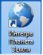.

Предварительно администратором системы должны быть осуществлены настройки клиентского места.

## 3.1 Основное окно программы

После запуска системы на экране появляется основное окно приложения с элементами интерфейса.

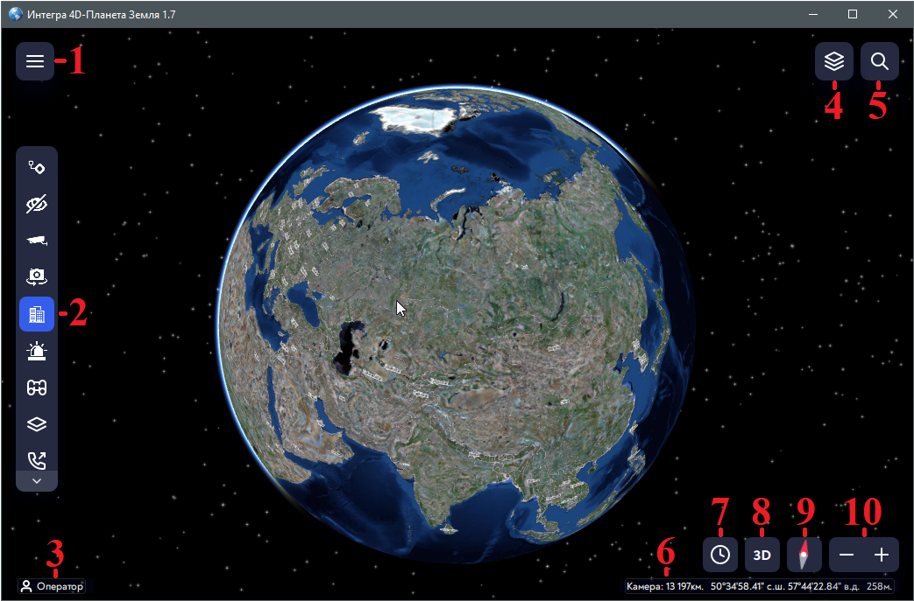
*Рис. 1. Основное окно системы «Интегра 4D - Планета Земля».*

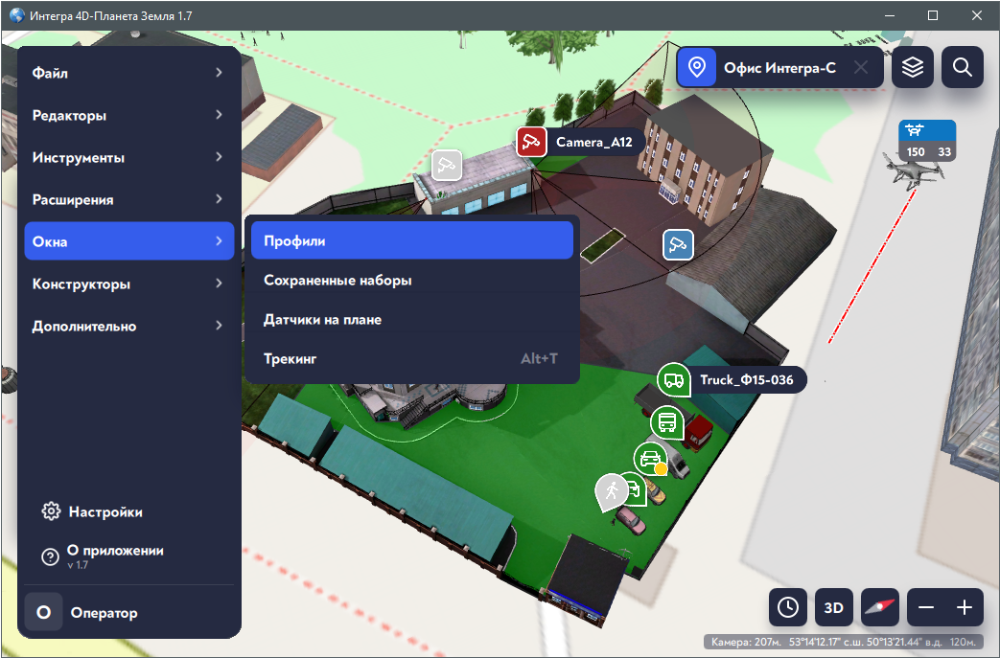
*Рис. 2. Основное меню программы «Интегра 4D - Планета Земля».*

Описание элементов интерфейса ПО «Клиент интеграции «Интегра-Планета» представлено в таблице 2.

*Таблица 2. Описание элементов интерфейса основного окна системы.*

| № п/п | Элемент | Описание |
| :---: | :--- | :--- |
| 1 | Главное меню | Содержит список основных категорий и функций программы (Рисунок 2).  При наведении курсора на пункты меню открывает подменю с соответствующими функциями.  Кнопка «Настройки» открывает настройки программы если у оператора есть право доступа к настройкам.  Кнопка «О программе» открывает окно с информацией о программе.  Кнопка «ФИО оператора» открывается карточку пользователя, в которой кнопка «Выйти» позволяет оператору выйти из системы. |
| 2 | Панель быстрого доступа | Позволяет пользователю переключаться между режимами работы программы и вызывать часто используемые функции. |
| 3 | ФИО пользователя | Отображает ФИО авторизованного пользователя. |
| 4 | Менеджер рабочих пространств | Позволяет управлять видимостью формуляров сопровождения, картографических слоев, датчиков и зон плана и объектов трекинга. |
| 5 | Поиск и навигация | Позволяет просмотр списка зданий и сооружений, поиск и фильтрацию. |
| 6 | Элементы навигации | Отображают высоту камеры вида над уровнем моря, координаты и высоту курсора на 3D-сцене. |
| 7 | Линейка времени | Позволяет задать дату и время и отобразить данные системы на указанный момент времени. |
| 8 | Режим позиционирования камеры вида | Выбор режима ограничивает угол обзора 3D-сцены: - 3D ‑ объемный режим; - 2D ‑ плоский режим. |
| 9 | Компас | Показывает направление сторон света. Нажатие кнопки ориентирует 3D-сцену в направлении севера. |
| 10 | Управление масштабом | Позволяет масштабировать карту. - **+** ‑ приближает 3D-сцену; - **−** ‑ отдаляет 3D-сцену. |

### 3.1.1 Масштабирование и ориентирование карты
Масштабирование карты позволяет уменьшать или увеличивать размер ее изображения. Для уменьшения масштаба карты следует прокрутить колесо мыши на себя. Для увеличения масштаба следует прокрутить колесо мыши от себя.

Ориентирование карты позволяет изменять положение карты. Для изменения положения карты следует зажать левую кнопку мыши и переместить карту в нужном направлении.

### 3.1.2 Менеджер пространств
Виджет «Менеджер пространств» используется для настройки видимости картографических слоев, датчиков, устройств и зон плана и объектов трекинга.

Кнопка  открывает виджет «Менеджер пространств» (Рисунок 3), для закрытия виджета нужно кликнуть вне виджета или повторно нажать кнопку .

Описание элементов интерфейса виджета «Менеджер пространств» представлено в таблице 3.

*Рис. 3-8. Менеджер пространств.*

*Таблица 3. Описание элементов интерфейса виджета «Менеджер пространств».*

| № п/п | Элемент | Описание |
| :---: | :--- | :--- |
| 1 | Список пространств | Содержит список всех существующих пространств. Пространство «Базовое» создается по умолчанию, в нем включено отображение всех элементов. Базовое пространство нельзя отредактировать, переименовать или удалить. |
| 2 | Выбранное / активное пространство | Настройки выбранного пространства применяются к 3D-сцене. Для активации слоя достаточно выбрать его в списке пространств. |
| 3 | Кнопка «Создать пространство / слой» | Открывает окно для создания и сохранения нового пространства. По умолчанию новый слой автоматически становиться активным. |
| 4 | Кнопка «Настроить» | Открывает настройки активного слоя для просмотра и/или редактирования. Любые изменения настроек слоя сохраняются автоматически. |
| 5 | Кнопка «Назад» | Закрывает настройки пространства. |
| 6 | Название редактируемого пространства | Отображает название пространства, которое выбрано для редактирования. |
| 7 | Кнопка «Меню» | Открывает меню дополнительных действий: - Переименовать - Дублировать - Свернуть все - Удалить |
| 8 | Поле «Поиск по названию» | Позволяет поиск по названию картографического слоя или названию типа датчиков и зон. |
| 9 | Формуляры отображения | Чекбокс включает/выключает отображение формуляров сопровождения объектов трекинга. |
| 10 | Вкладки | Основные вкладки настроек: Картография, Датчики плана, Датчики трекинга. |
| 11 | Списки элементов вкладок | Содержат элементы, соответствующие вкладкам. |

Примеры активации пространств с разными настройками видимости элементов:

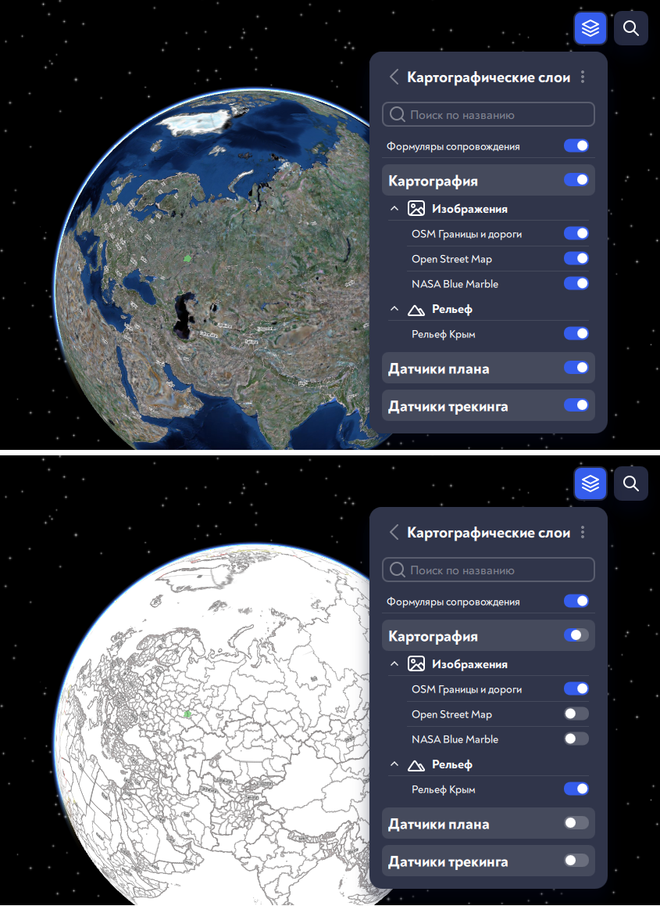
*Рис. 9. Настройка видимости картографических слоев.*

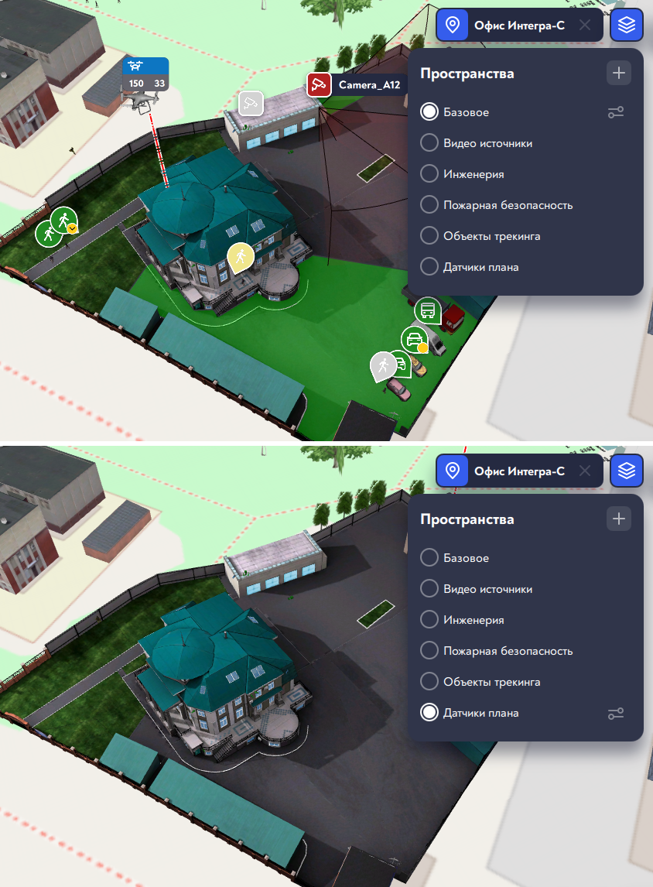
*Рис. 10. Настройка видимости некоторых типов датчиков.*

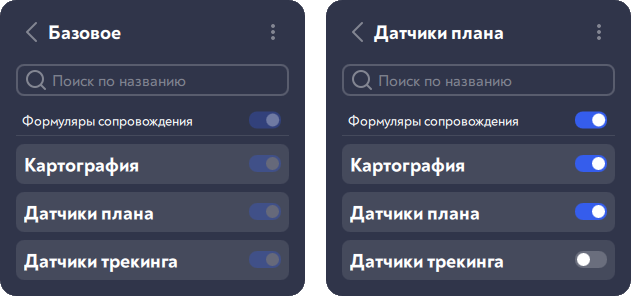
*Рис. 11. Настройки разных пространств.*

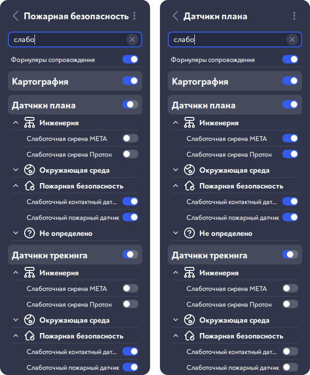
*Рис. 12. Настройки разных пространств.*

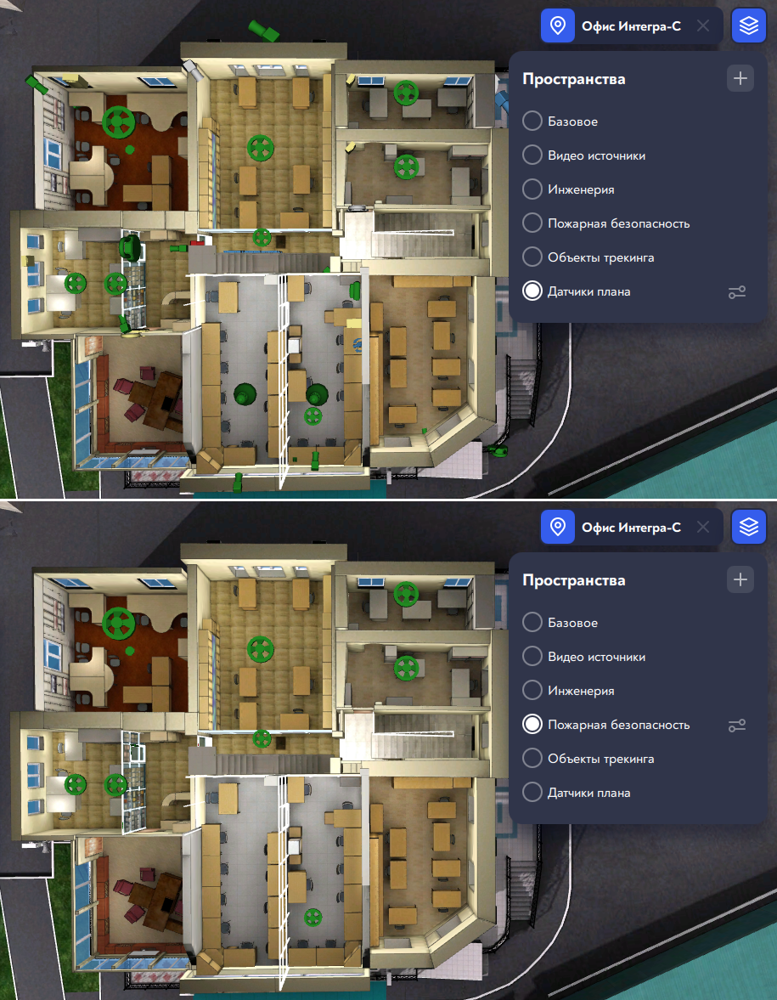
*Рис. 13. Настройка видимости некоторых типов датчиков.*

## 3.2 Поиск и навигация

Виджет «Поиск и навигация» используется для перехода к плану объекта. Поиск осуществляется по названию плана объекта, его адресу и внутри группы объектов. Для перелета к нужному плану или его профилю достаточно выбрать его название в списке зданий и сооружений.

Кнопка  открывает виджет «Поиск и навигация» (Рисунок 14), для закрытия виджета нужно кликнуть вне виджета или повторно нажать кнопку .

*Таблица 4. Описание элементов интерфейса виджета «Поиск и навигация».*

| № п/п | Элемент | Описание |
| :---: | :--- | :--- |
| 1 | Поле «Поиск по названию» | Позволяет поиск по названию плана / здания или сооружения. |
| 2 | Кнопка «Закрепить / открепить» | Позволяет закрепить виджет в открытом виде. |
| 3 | Вкладки | Основные вкладки виджета: - Все ‑ содержит список всех существующих зданий и сооружений. - Избранное ‑ содержит список часто используемых планов. - Группы ‑ содержит списки планов, отсортированных по группам зданий. - Адреса ‑ позволяет произвести поиск плана по адресу. |
| 4 | Плоский список планов | Список планов отображается в виде плоского списка. |
| 5 | Дерево планов | Список планов отображается в виде дерева. |

### 3.2.1 Пользовательская сортировка дерева планов
Для редактирования дерева планов нужно в виджете «Поиск и навигация» на вкладке «Все» в режиме «Дерево планов» нажать кнопку «Редактировать» . В результате виджет перейдет в режим редактирования (Рисунки 20 и 21).

Кнопка «Завершить» возвращает виджет к режиму просмотра. Кнопка «Меню»  открывается дополнительную возможность «Сортировать по алфавиту».

Для перемещения элемента в списке любого уровня требуется выбрать его ЛКМ и, удерживая ее, переместить вверх или вниз по списку на нужную позицию и отпустить ЛКМ (Рисунок 22).

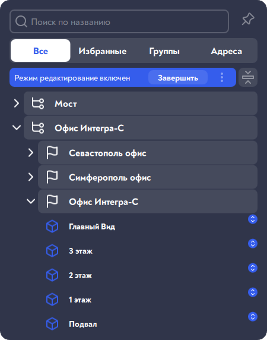
*Рис. 20. Дерево планов.*

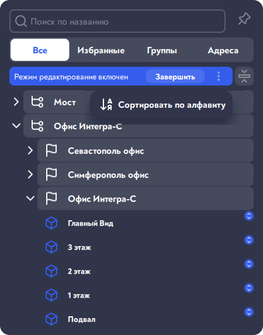
*Рис. 21. Дерево планов.*

## 3.3 Планы зданий и сооружений

### 3.3.1 Загрузка плана
После выбора здания или сооружения на экране откроется его графический план объекта (Рисунок 23), на котором расположены элементы в соответствии с их фактическим расположением на местности.

Для работы с планом объекта должна быть включена функциональная кнопка «Управление объектами»  в панели быстрого доступа.

Активация / выбор плана производится нажатием по нему ЛКМ, после этого в правом верхнем углу основного окна программы появится название выбранного плана.

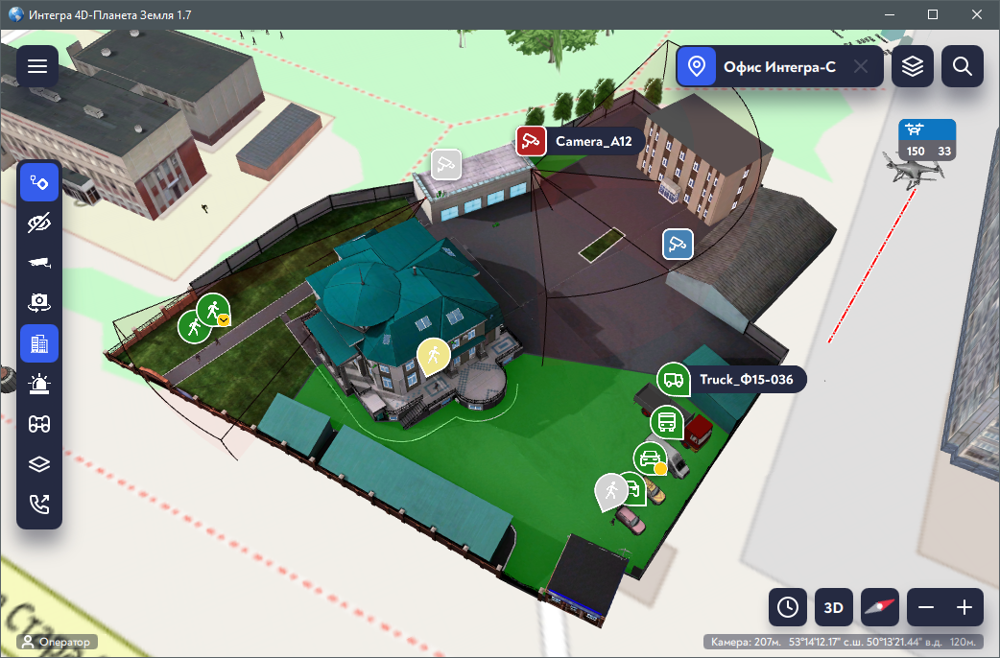
*Рис. 23. Выбранный объект «Офис Интегра-С».*

### 3.3.2 Профили плана
В окне «Профили» показаны профили / виды активного плана.

Для выбора профиля здания следует активировать его план и в главном меню программы перейти в подменю «Окна», выбрать пункт «Профили», в открывшемся окне «Профили» выбрать требуемый профиль (Рисунок 24). Для отключения подлета надо нажать кнопку «Выключить подлет к выбираемому плану» , для включения - нажать кнопку «Включить подлет к выбираемому плану» .

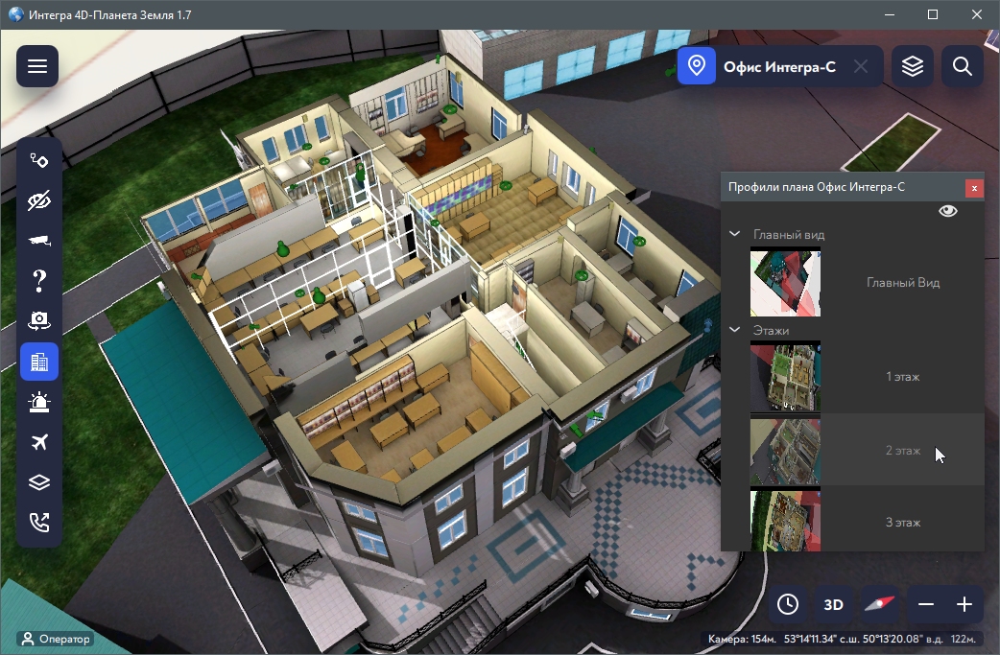
*Рис. 24. Окно «Профили».*

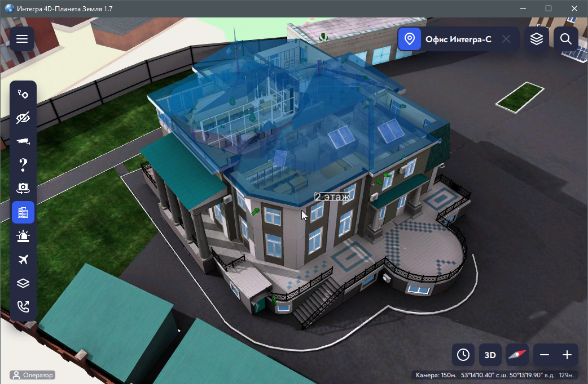
*Рис. 25. Выбор профиля активного плана.*

### 3.3.3 Загрузка устройств плана
После загрузки 3D-модели плана начинают загружаться данные со связанного сервера и данные с сервера трекинга. Процесс загрузки показан на рисунке 26.

*Рис. 26. Этапы загрузки плана.*

Для просмотра списка всех устройств, расположенных на плане, нужно его активировать и в главном меню программы перейти в подменю «Окна», выбрать пункт «Датчики на плане».

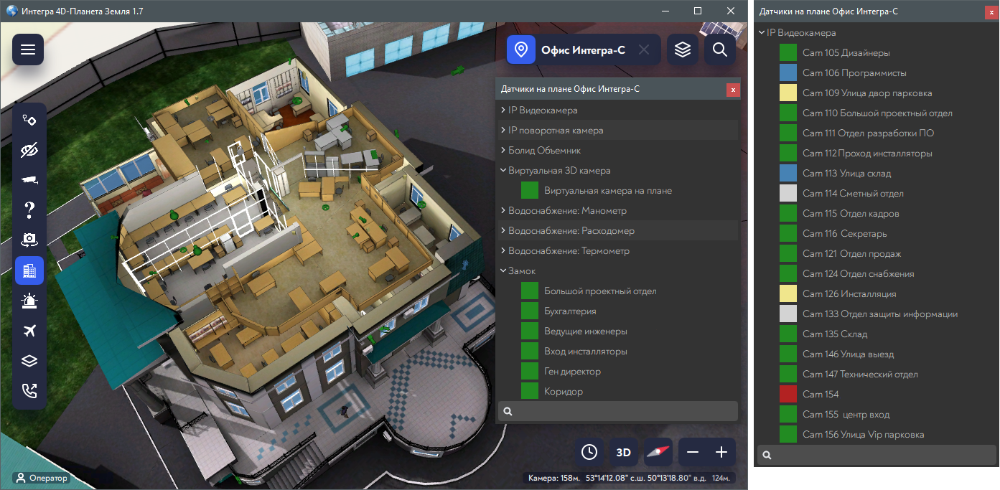
*Рис. 27. Датчики на плане.*

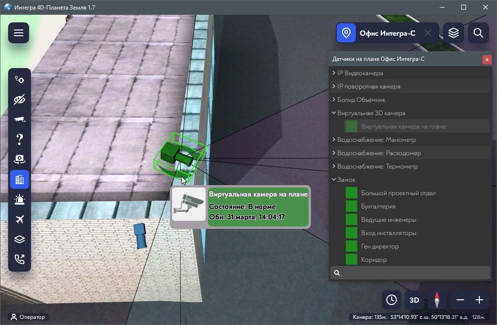
*Рис. 28. Датчики на плане.*

# 4. Объекты трекинга

Объекты трекинга ‑ это датчики не привязанные к плану. У объектов трекинга на 3D-сцене отображаются формуляры сопровождения, важно чтобы у активного пространства не было выключено отображение формуляров.

Для просмотра списка всех объектов трекинга нужно в главном меню программы перейти в подменю «Окна», выбрать пункт «Трекинг», в открывшемся окне «Данные трекер-системы» будут отображаться все датчики плана, сгруппированные по серверам и по типу датчиков (Рисунок 29).

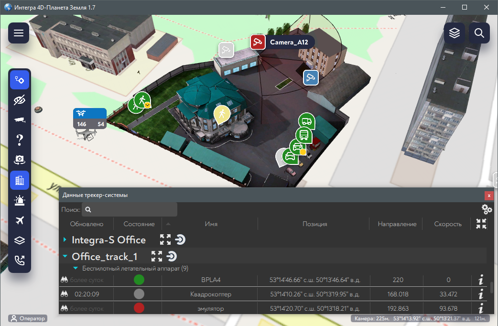
*Рис. 29. Данные трекер-системы.*

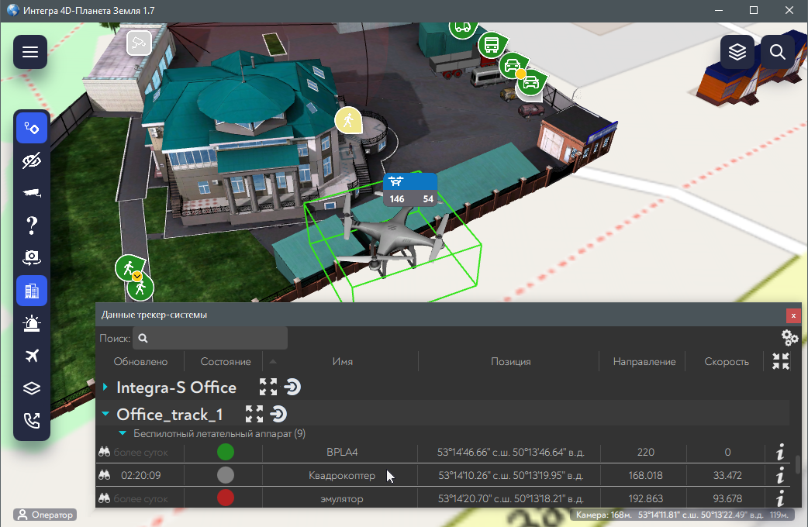
*Рис. 30. Данные трекер-системы.*

# 5. Описание операций

## 5.1 Взаимодействие с датчиками
При наведении курсора мыши на 3D-модель датчика и зону плана или трекинга появляется всплывающая подсказка с краткой информацией о нём (Рисунок 31).

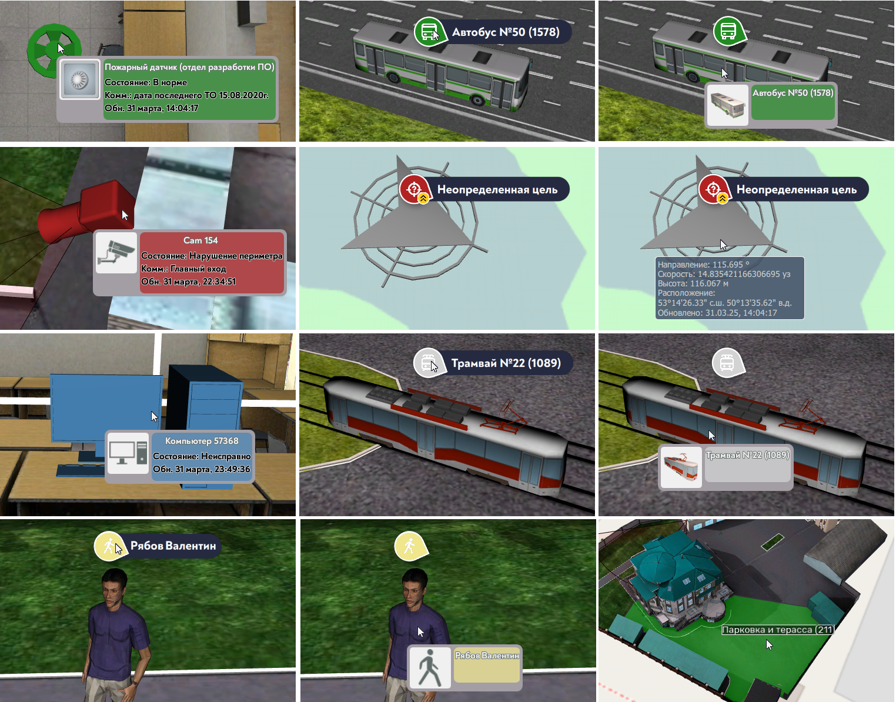
*Рис. 31. Информационное окно устройства.*

Устройство или зону можно выбрать двумя способами:
* ЛКМ ‑ у датчика появится рамка (Рисунок 32)
* ПКМ ‑ откроется малый информационный виджет рядом с датчиком (Рисунок 33).

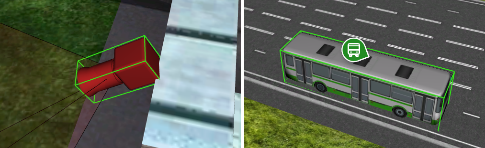
*Рис. 32. Выбранное устройство.*

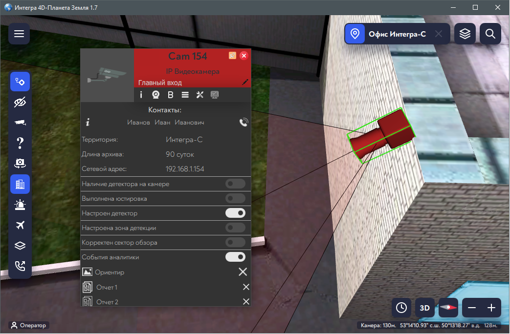
*Рис. 33. Информационное окно выбранного устройства.*

Для того чтобы поставить устройство на охрану или снять его с охраны, следует нажать кнопку «Команды»  и в меню выбрать необходимое действие: взять под охрану, снять с охраны, игнорировать, отмена (Рисунок 34).

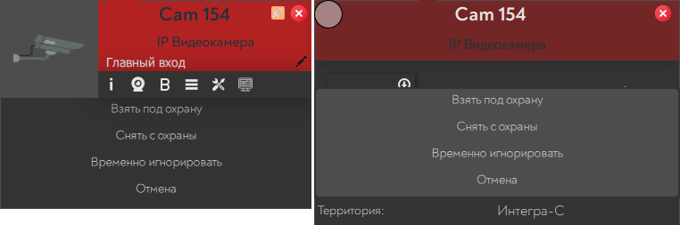
*Рис. 34. Информационные окно и панель устройства.*

## 5.2 Индикация состояния устройств
Цветовая индикация датчиков, устройств, объектов трекинга и зон предназначена для визуального контроля за их состоянием. 

*Таблица 5. Описание цветовой индикации состояния устройств.*

| № п/п | Цвет | Состояние устройства |
| :---: | :--- | :--- |
| 1 | Зеленый | Устройство исправно. |
| 2 | Красный | Устройство в тревоге. |
| 3 | Синий | Устройство неисправно. |
| 4 | Серый | Неизвестно состояние устройства. |
| 5 | Желтый | Устройство игнорируется. |

## 5.3 Просмотр видеоизображения с видеокамер
Для открытия видеоизображения с камеры нужно двойным щелчком ЛКМ выбрать видеокамеру, или нажатием кнопки «Видеоизображение»  или  в одном из его информационных виджетов.

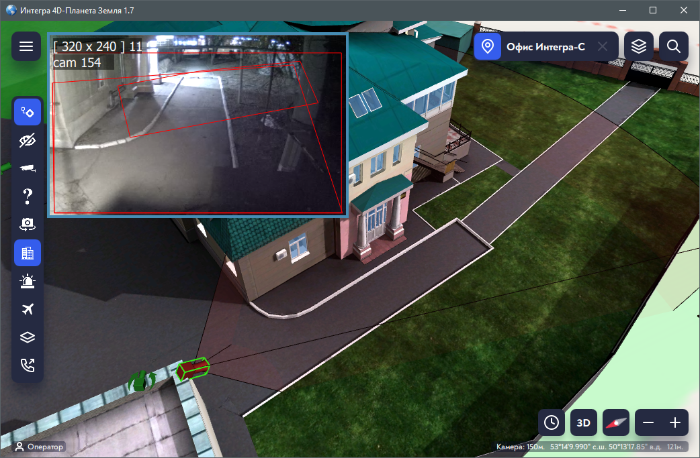
*Рис. 36. Окно видеонаблюдения.*

### 5.3.1 Окно видеоклиента в режиме реального времени
Окно видеоклиента с элементами управления представлено на рисунке 37.

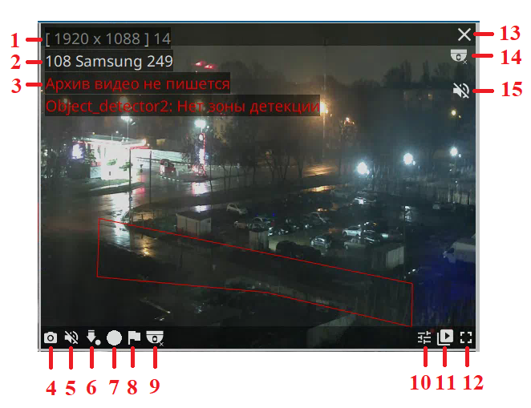
*Рис. 37. Окно видеоклиента в реальном времени.*

Если видеокамера оснащена микрофоном, то в нижней панели окна присутствует кнопка «Включить/отключить звук»  (Рисунок 38), с помощью которой также настраивается громкость.

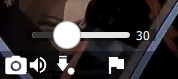
*Рис. 38. Кнопка «Включить/отключить звук».*

Если камера поворотная, то в нижней панели присутствует кнопка управления поворотной камерой . 

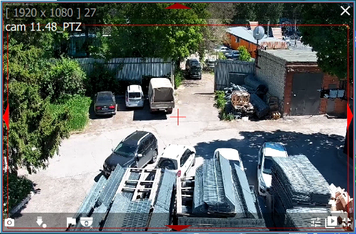
*Рис. 39. Окно поворотной камеры.*

#### 5.3.1.1 Меню камеры видеонаблюдения
Для вызова меню камеры видеонаблюдения (Рисунок 40) надо нажать правой кнопкой мыши в окне видеоклиента.

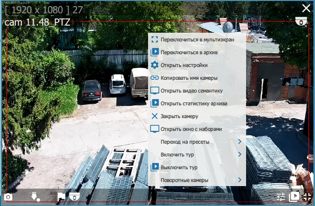
*Рис. 40. Меню камеры видеонаблюдения в реальном времени.*

#### 5.3.1.2 Контекстное меню поворотных камер
При нажатии правой кнопкой мыши по поворотной камере в реалтайм режиме будет открыто контекстное меню с элементами управления поворотной камерой (Рисунок 41).

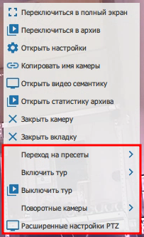
*Рис. 41. Контекстное меню управления поворотными камерами (ptz)*

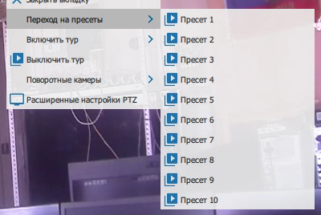
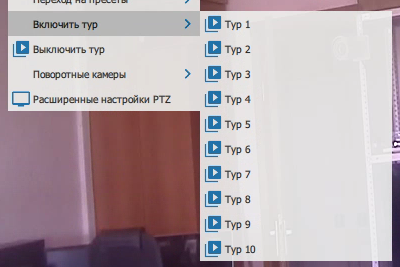
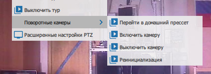

#### 5.3.1.2.1 Расширенное меню управления поворотными камерами (ptz)
На рисунке 42 представлено расширенное меню управления поворотными камерами.

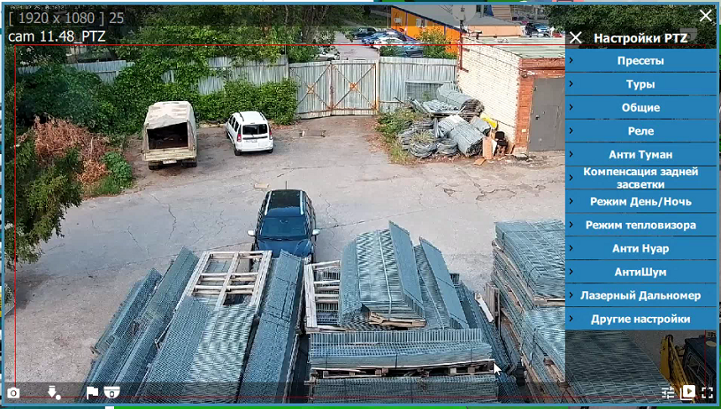
*Рис. 42. Расширенное меню управления поворотными камерами (ptz).*

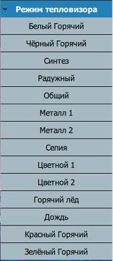
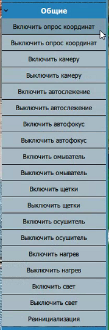
*Рис. 43. Расширенное меню управления поворотными камерами (ptz) / раздел Общие.*

### 5.3.2 Просмотр архивного видеоизображения
Для перехода в режим просмотра архивного видеоизображения (Рисунок 44) следует выбрать пункт «Переключиться в архив» в меню (Рисунок 41) или воспользоваться кнопкой «Архив» в панели окна видеоклиента.

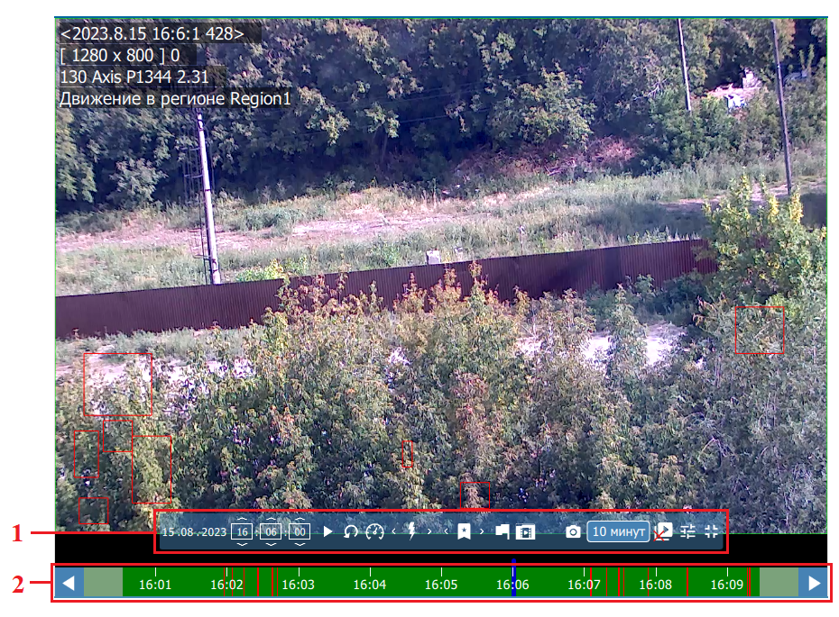
*Рис. 44. Окно видеонаблюдения в архивном режиме.*

Изменение масштаба временной полосы осуществляется как при помощи соответствующей кнопки на архивной панели , так и колесиком мыши.

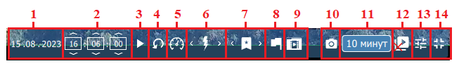
*Рис. 45. Панель управления архивом.*

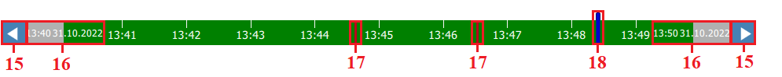
*Рис. 46. Шкала даты и времени.*

Для выбора архивного видеоизображения для просмотра следует вызвать календарь (Рисунок 47) соответствующей кнопкой на панели управления архивом и выбрать или ввести в нем дату.

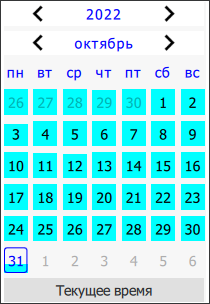
*Рис. 47. Календарь.*

#### 5.3.2.1 Экспортирование видеоархива в медиафайл
Для экспортирования видеоархива в медиафайл следует на полосе воспроизведения выбрать интервал для выгрузки с помощью кнопки . В выбранном месте появится знак 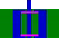.

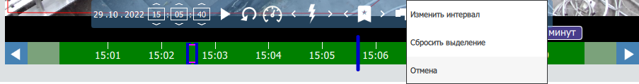
*Рис. 48. Меню для выделения интервала.*

*Рис. 49. Выделенный интервал.*

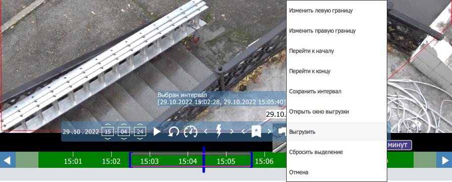
*Рис. 50. Меню для выделения интервала.*

В результате появится строка экспорта (Рисунок 51). При нажатии на кнопки  откроется папка, куда производится выгрузка,  - загрузка прервется.

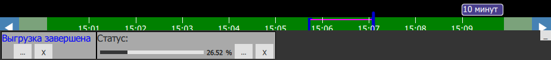
*Рис. 51. Строка экспорта.*

#### 5.3.2.1.1 Меню инструментов управления интервалами для выгрузки
Меню, содержащее инструменты управления интервалами для выгрузки, представлено на рисунке 52.

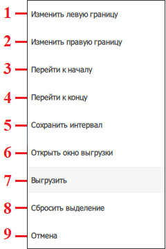
*Рис. 52. Меню для выделения интервала.*

#### 5.3.2.2 Экспортирование видеоархива в медиафайл через окно экспорта
Для экспортирования видеоархива в медиафайл через окно экспорта на панели управления архивом следует нажать кнопку «Экспорт» . 

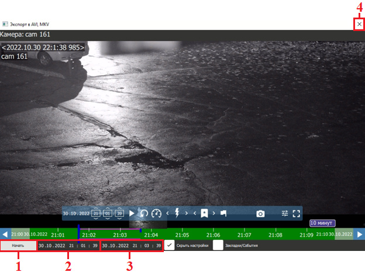
*Рис. 53. Окно экспорта.*

### 5.3.3 Система цифрового видеонаблюдения
В окне «QML клиент» производится отображение видеопотоков с видеокамер. 

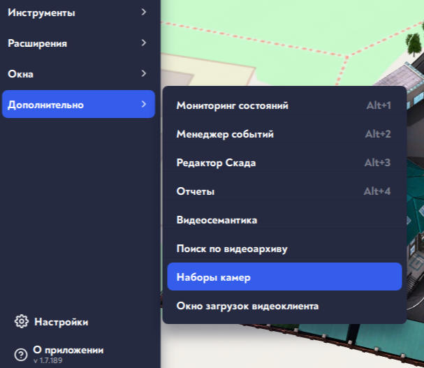
*Рис. 54. Меню «Дополнительно»*

На экране появится окно «QML клиент», представленное на рисунке 55.

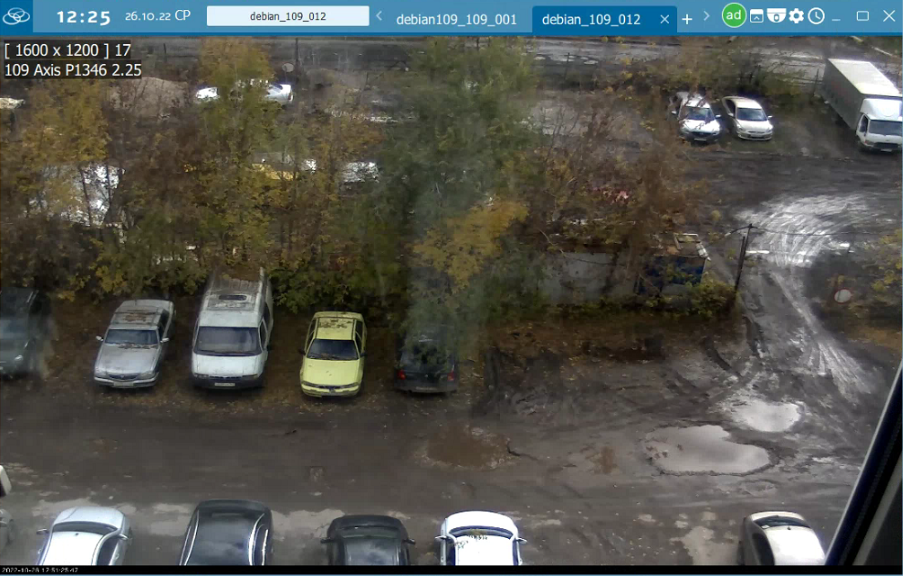
*Рис. 55. Окно «QML клиент».*

#### 5.3.3.1 Панель меню
Описание общей панель меню для видеоклиента (Рисунок 56).

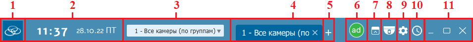
*Рис. 56. Панель окна «QML-клиент».*

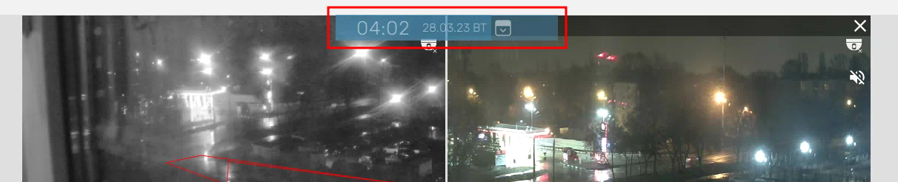

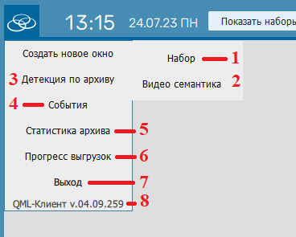
*Рис. 57. Меню создания окон.*

#### 5.3.3.1.1 Прогресс выгрузок
Окно прогресса выгрузок (Рисунок 58) позволяет вывести в одно окно все статусы текущих и завершенных выгрузок. Окно можно открыть через меню создания окон .

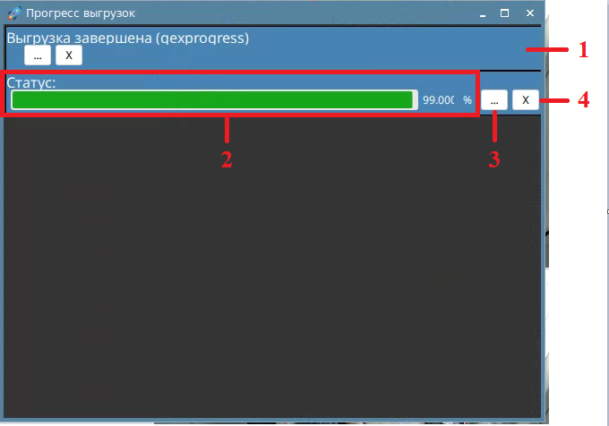
*Рис. 58. Окно прогресса выгрузок.*

#### 5.3.3.1.2 Панель выбора наборов
Панель выбора наборов (Рисунок 59) позволяет производить фильтрацию для быстрого поиска набора или видеокамеры.

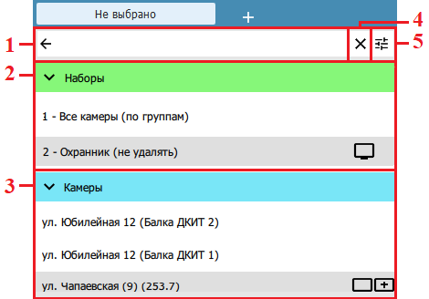
*Рис. 59. Панель выбора наборов.*

Чтобы вывести на экран требуемый набор следует выбрать его левой кнопкой мыши или нажать на иконку  в строке набора. Для добавления к текущему набору нажать иконку .

### 5.3.4 Видеосемантика

#### 5.3.4.1 Показ видеозаписей
В окне «Видеосемантика» производится отображение видеосюжетов событий с видеокамер. 

*Рис. 60. Окно «Видеосемантика».*

Меню настроек открывается кнопкой  в окне «Видеосематика».

*Рис. 61. Выпадающее меню окна «Видеосематика».*

*Рис. 62. Меню настроек ключевых типов событий.*

*Рис. 63. Поисковая строка для настройки ключевых типов событий.*

Для установки других параметров требуется нажать на кнопку .

*Рис. 64. Меню настроек.*

*Рис. 65. Окно «Видеосематика».*

*Рис. 66. Меню общих настроек.*

*Рис. 67. Меню общих настроек.*

*Рис. 68. Меню общих настроек.*

*Рис. 69. Меню общих настроек.*

#### 5.3.4.2 Показ видеозаписей ключевых событий
В окне «Видеосемантика» оператор может принять или отклонить событие (Рисунок 70).

*Рис. 70. Окно выбранного видеосюжета события.*

## 5.4 Контроль и обработка событий

### 5.4.1 Менеджер событий

#### 5.4.1.1 Обработка событий
В окне «Менеджер событий» собираются и отображаются все события, происходящие на одном или нескольких объектах в режиме реального времени.

*Рис. 71. Окно «Менеджер событий».*

*Рис. 72. Панель инструментов окна «Менеджер событий».*

*Рис. 73. Окно «Статистика».*

Если событие требует обработки оператором, в поле «Статус» станут доступны кнопки «Принять»  или «Отклонить» .

*Рис. 74. Окно «Комментарий к событию».*

*Рис. 75. Статус события в поле «Статус»*

*Рис. 76. Окно «Комментарий к событию».*

*Рис. 77. Комментарий к событию в поле «Комментарий».*

*Рис. 78. Окно «Комментарий к событию».*

*Рис. 79. Всплывающая подсказка*

#### 5.4.1.2 Вкладки
Все поступающие события в окне «Менеджер событий» распределяются по вкладкам в зависимости от настроек.

*Рис. 80. Вкладки в окне «Менеджер событий».*

#### 5.4.1.3 Просмотр видеоизображения
Для воспроизведения видеоизображения с места события надо нажать на кнопку «Показать камеру»  и  в строке события.

*Рис. 81. Кнопка «Показать камеру» в поле «Действия».*

*Рис. 82. Окно видеоклиента с места события в режиме реального времени.*

#### 5.4.1.4 Переход на объект
Для перехода на место события на плане надо нажать на кнопку «Перейти к объекту»  в строке события.

*Рис. 83. Кнопка «Перейти к объекту» в поле «Действия».*

*Рис. 84. Автоматический переход к устройству, от которого поступило событие.*

Для просмотра расширенного состояния устройства следует нажать на кнопку  в строке события.

*Рис. 85. Дополнительная информация по событию в менеджере событий.*

#### 5.4.1.5 Регламент действий
Регламент действий --- это веб-компонент, реализованный в виде настраиваемого уведомления.

*Рис. 86. Уведомление.*

По нажатию на кнопку  будет выполнен перелет к датчику-источнику или событию.

#### 5.4.1.6 Режимы обработки событий
В зависимости от установленных настроек системы, работа с очередью событий осуществляется в одном из трех режимов (Последовательная, Непоследовательная, Комбинированный режим).

*Рис. 87. Возможность переключения событий*

#### 5.4.1.7 Автоматические действия
Автоматические действия выполняются только для текущего выбранного события.

### 5.4.2 Отправка отложенных команд из виджета

#### 5.4.2.1 Алгоритм создания отложенной команды:
Пользователь имеет возможность назначить датчику время работы команды.

*Рис. 88. Виджет датчика*

*Рис. 89. Список доступных команд*

*Рис. 90. Изменение команды датчика*

Нажать на кнопку в виде часов  рядом с выбранной командой для задания таймера.

*Рис. 91. Кнопка для задания таймера*

*Рис. 92. Настройка времени активации для команды*

*Рис. 93. Перерасчет времени*

*Рис. 94. Появление таймера напротив команды*

*Рис. 95. Отключение таймера до его срабатывания*

*Рис. 96. Изменение команды по истечению таймера*

#### 5.4.2.2 Автозакрытие виджета после отправки команд.
Чтобы включить автозакрытие виджета после отправки команд, откройте настройки Планеты на вкладке «Общие».

*Рис. 97. Выбрать вкладку в настройках*

*Рис. 98. Настройка автозакрытия виджета*

*Рис. 99. Применение настройки.*

### 5.4.3 Таблица наблюдений.
Это приложение используется для отслеживания изменений и взаимодействия с датчиками.

#### 5.4.3.1 Главная страница приложения.

*Рис. 100. Окно таблицы наблюдений*

*Рис. 101. Панель инструментов*

*Рис. 102. Мини-профиль пользователя*

#### 5.4.3.2 Таблица с данными.

*Рис. 103. Отображение таблицы без групп*

*Рис. 104. Отслеживание изменения параметра*

*Рис. 105. Вид таблицы с группами датчиков*

#### 5.4.3.3 Основные возможности управления таблицей:

*Рис. 106. Меню действий*

*Рис. 107. Кнопка развернуть / свернуть у группы*

*Рис. 108. Кнопка развернуть / свернуть все группы в заголовке таблицы*

*Рис. 109. Включение/отключение отображения датчиков*

#### 5.4.3.4 Управления датчиками в таблице.

*Рис. 110. Вызов меню управления датчиком с помощью ПКМ*

*Рис. 111. Управление параметром датчика*

*Рис. 112. Вызов меню управления датчиком через контекстное меню*

*Рис. 113. Управление параметром датчика*

*Рис. 114. Изменение параметров у всех датчиков на вкладке*

*Рис. 115. Изменение параметров у группы датчиков.*

#### 5.4.3.5 Сигнальное отображение.
В таблице реализована возможность сигнального отображения как всей строки, так и отдельного столбца.

*Рис. 116. Окрашивание строки в зависимости от значения.*

*Рис. 117. Окрашивание столбца в зависимости от значения.*

#### 5.4.3.6 Нижняя панель управления
Так как объектов может быть много, они разбиты на страницы.

### 5.4.4 Мониторинг состояний

#### 5.4.4.1 Обработка событий

*Рис. 118. Окно «Мониторинг состояний».*

*Рис. 119. Отображение категории IP видеокамеры в окне «Мониторинг состояний».*

*Рис. 120. Расширенное состояние выбранной категории.*

*Рис. 121. Список устройств выбранной категории.*

*Рис. 122. Список устройств выбранного состояния.*

*Рис. 123. Подробная информация состояния неисправного устройства.*

*Рис. 124. Подробная информация состояния исправного устройства.*

#### 5.4.4.2 Переход к устройству на плане

*Рис. 125. Переход к выбранному устройству на плане.*

### 5.4.5 Отчеты

#### 5.4.5.1 Формирование формы отчета за указанный период

*Рис. 126. Окно «Отчёты».*

*Рис. 127. Поля для ввода временного интервала для формирования отчета.*

*Рис. 128. Форма отчета за указанный период времени.*

#### 5.4.5.2 Формирование формы отчетов по действиям оператора

*Рис. 129. Поля для ввода временного интервала для формирования отчета.*

*Рис. 130. Форма отчета по действиям оператора*

#### 5.4.5.3 Просмотр архивного видеоизображения
Для воспроизведения архивного видеоизображения надо нажать на кнопку «Показать архив»  в строке события.

*Рис. 131. Окно «Отчёты».*

*Рис. 132. Архивное видеоизображение с места события.*

#### 5.4.5.4 Переход на объект
Для перехода на место события на плане надо нажать на кнопку «Перейти на объект»  в строке события.

*Рис. 133. Окно «Отчёты».*

# 6. Аварийные ситуации

«Клиент интеграции технической системы сбора и обработки информации «Интегра Планета» является сложным программным обеспечением, установка и настройка которого осуществляется администраторам.

При внезапном прекращении работы клиентского места требуется перезапустить программу двойным щелчком левой кнопки мыши по ярлыку на рабочем столе: 

# 7. Рекомендации к освоению

Для успешной работы с программным обеспечением «Клиент интеграции технической системы сбора и обработки информации «Интегра Планета» необходимо:
* ознакомиться с документом «Описание программного обеспечения «Клиент интеграции технической системы сбора и обработки информации «Интегра-Планета» RU.ТГРШ.505900-20-10-01 13;
* ознакомиться с данным руководством пользователя.